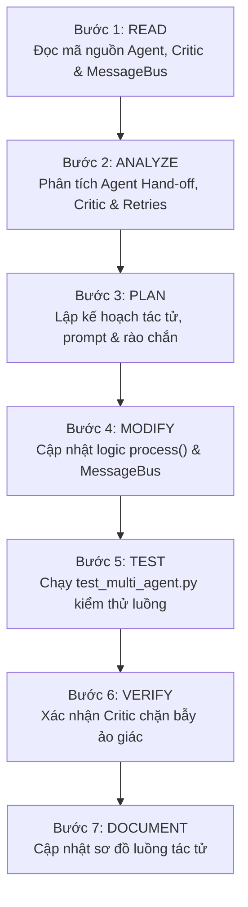

# AI Agent Skill

## 1. Purpose

Skill này hướng dẫn AI Agent chuyên môn hóa việc phân tích, cấu hình, vận hành và mở rộng Hệ thống Đa tác tử (Multi-Agent Architecture) trong dự án `EventAI Pro`. Kỹ năng tập trung vào việc quản trị vòng đời và sự phối hợp giữa 7 tác tử chuyên trách (`Orchestrator`, `Requirement`, `Retrieval`, `Critic`, `Response`, `Knowledge`, `Recommendation`), quản lý trục truyền tin nội bộ (`MessageBus`), thực thi cơ chế rào chắn kiểm duyệt chất lượng (`Critic Guardrail`) nhằm loại bỏ hoàn toàn hiện tượng ảo giác (Hallucination) và đảm bảo thỏa mãn 100% ràng buộc của người dùng (Constraint Satisfaction).

## 2. Capability

- **Điều phối Đa tác tử (Multi-Agent Orchestration):** Quản lý luồng thực thi tuần tự và song song của 7 tác tử thông qua lớp điều phối trung tâm [app/agents/orchestrator_agent.py](file:///d:/Event_Management_AI/app/agents/orchestrator_agent.py).
- **Phân rã Yêu cầu & Ràng buộc (Requirement Decomposition):** Tác tử `RequirementAgent` bóc tách ý định, danh mục, địa điểm, ngân sách tối đa, định dạng sự kiện và thời gian từ câu hỏi tự nhiên.
- **Truy xuất Đa phương thức (Hybrid Retrieval):** Tác tử `RetrievalAgent` và `KnowledgeAgent` truy xuất dữ liệu từ cơ sở dữ liệu quan hệ (SQL) kết hợp cơ sở dữ liệu vector/FAISS nhằm tối ưu ngữ cảnh.
- **Rào chắn Kiểm duyệt Độc lập (Critic Guardrail & Fact Checking):** Tác tử `CriticAgent` đóng vai trò cổng kiểm duyệt độc lập: phân tích câu trả lời dự kiến đối chiếu với dữ liệu thực tế trong CSDL, đưa ra phán quyết `APPROVE` hoặc `REJECT` kèm lý do vi phạm.
- **Vòng lặp Hiệu chỉnh Tự động (Refinement Feedback Loop):** Khi Critic từ chối (`REJECTED`), Orchestrator tự động gửi phản hồi yêu cầu `ResponseAgent` hoặc `RetrievalAgent` biên soạn lại (tối đa 2 lần retry trước khi kích hoạt Safe Fallback).
- **Trục Truyền tin & Nhật ký Kiểm toán (Message Bus & Audit Trail):** Ghi vết toàn bộ thông điệp trao đổi giữa các tác tử trong phiên làm việc thông qua [app/services/multi_agent/message_bus.py](file:///d:/Event_Management_AI/app/services/multi_agent/message_bus.py).

## 3. Scope

- Toàn bộ 7 tác tử trong thư mục [app/agents/](file:///d:/Event_Management_AI/app/agents/):
  - [app/agents/base_agent.py](file:///d:/Event_Management_AI/app/agents/base_agent.py): Lớp cơ sở định nghĩa hợp đồng chung `Agent` và phương thức `process()`.
  - [app/agents/orchestrator_agent.py](file:///d:/Event_Management_AI/app/agents/orchestrator_agent.py): Nhạc trưởng điều phối luồng.
  - [app/agents/requirement_agent.py](file:///d:/Event_Management_AI/app/agents/requirement_agent.py): Bóc tách ràng buộc người dùng.
  - [app/agents/retrieval_agent.py](file:///d:/Event_Management_AI/app/agents/retrieval_agent.py): Truy vấn và xếp hạng sự kiện CSDL.
  - [app/agents/critic_agent.py](file:///d:/Event_Management_AI/app/agents/critic_agent.py): Thẩm định sự thật và phát hiện Hallucination.
  - [app/agents/response_agent.py](file:///d:/Event_Management_AI/app/agents/response_agent.py): Biên tập câu trả lời cuối cùng.
  - [app/agents/knowledge_agent.py](file:///d:/Event_Management_AI/app/agents/knowledge_agent.py): Trả lời câu hỏi thường gặp FAQs.
  - [app/agents/recommendation_agent.py](file:///d:/Event_Management_AI/app/agents/recommendation_agent.py): Cá nhân hóa gợi ý sự kiện.
- Dịch vụ hỗ trợ tác tử trong [app/services/multi_agent/](file:///d:/Event_Management_AI/app/services/multi_agent/):
  - [app/services/multi_agent/message_bus.py](file:///d:/Event_Management_AI/app/services/multi_agent/message_bus.py): Trục truyền tin nội bộ.
  - [app/services/multi_agent/agent_llm.py](file:///d:/Event_Management_AI/app/services/multi_agent/agent_llm.py): Cổng giao tiếp LLM.
  - [app/services/multi_agent/database_service.py](file:///d:/Event_Management_AI/app/services/multi_agent/database_service.py): Truy xuất SQL.
  - [app/services/multi_agent/vector_service.py](file:///d:/Event_Management_AI/app/services/multi_agent/vector_service.py): Truy xuất Vector/FAISS.
- Kho prompt mẫu của tác tử: `app/prompts/multi_agent/`.

## 4. Non-Scope

- Không thay thế luồng RAG đơn tác tử (Single-Agent RAG) tại `app/services/rag_service.py` (thuộc skill [rag-prompt](file:///d:/Event_Management_AI/.agents/skills/rag-prompt/SKILL.md) và [context-builder](file:///d:/Event_Management_AI/.agents/skills/context-builder/SKILL.md)).
- Không thực hiện đo lường đánh giá hiệu năng benchmark tự động (thuộc skill [ai-evaluation](file:///d:/Event_Management_AI/.agents/skills/ai-evaluation/SKILL.md)).
- Không chỉnh sửa giao diện trò chuyện HTML/CSS (thuộc skill [frontend-development](file:///d:/Event_Management_AI/.agents/skills/frontend-development/SKILL.md)).

## 5. When to Use

- Khi người dùng tương tác trong không gian làm việc AI nâng cao (`/ai/workspace`) hoặc kích hoạt luồng tư vấn đa tác tử.
- Khi cần bổ sung thêm một tác tử chuyên biệt mới (ví dụ: `PaymentAgent`, `ScheduleAgent`).
- Khi phát hiện hiện tượng ảo giác (AI bịa đặt ra sự kiện không có trong cơ sở dữ liệu).
- Khi Critic Guardrail bị lọt lỗi (False Negative) hoặc chặn nhầm câu trả lời hợp lệ (False Positive).
- Khi cần kiểm tra lịch sử vết giao tiếp giữa các tác tử phục vụ kiểm toán an toàn AI.

## 6. When NOT to Use

- Khi người dùng chỉ hỏi câu chào hỏi xã giao thông thường tại Single-Agent Chat (dùng skill [rag-prompt](file:///d:/Event_Management_AI/.agents/skills/rag-prompt/SKILL.md)).
- Khi viết các câu lệnh truy vấn CSDL độc lập không phục vụ Agent (dùng skill [database-design](file:///d:/Event_Management_AI/.agents/skills/database-design/SKILL.md)).
- Khi triển khai môi trường Docker lên máy chủ (dùng skill [deployment](file:///d:/Event_Management_AI/.agents/skills/deployment/SKILL.md)).

## 7. Trigger Conditions

- Người dùng yêu cầu tư vấn các sự kiện phức tạp có nhiều ràng buộc chồng chéo (ngân sách, thành phố, diễn giả, thời gian).
- Phát hiện câu hỏi gài bẫy (Adversarial Trap / Hallucination Trap) về sự kiện giả mạo.
- Cần mở rộng hoặc tối ưu hóa prompt của một trong 7 tác tử chuyên trách.
- Cần tinh chỉnh ngưỡng từ chối của `CriticAgent`.

## 8. Required Context

Agent cần nắm rõ:

- Cấu trúc bản tin Message Bus:

  ```python
  {
      "sender": "AgentName",
      "recipient": "Orchestrator" | "All",
      "content": {...},
      "timestamp": "ISO-8601"
  }
  ```

- Tiêu chí đánh giá của `CriticAgent`:
  1. `Constraint Satisfaction`: Câu trả lời có vi phạm mức giá, địa điểm, thời gian mà người dùng yêu cầu không?
  2. `Factual Grounding`: Tên sự kiện, diễn giả, giá vé có khớp 100% với dữ liệu CSDL hay là suy đoán bừa bãi?
  3. `Rejection Format`: Khi từ chối, bắt buộc trả về `{"verdict": "REJECTED", "reason": "...", "suggestions": [...]}`.
- Cơ chế Fallback an toàn: Nếu qua 2 lần retry mà Critic vẫn Reject, Orchestrator trả về thông điệp an toàn: *"Hiện tại hệ thống không tìm thấy sự kiện nào thỏa mãn chính xác các tiêu chí của bạn trong cơ sở dữ liệu."*

## 9. Source Files to Inspect

Trước khi sửa đổi hoặc điều phối tác tử, Agent PHẢI đọc các tệp sau:

- [app/agents/base_agent.py](file:///d:/Event_Management_AI/app/agents/base_agent.py): Định nghĩa lớp cha `BaseAgent`.
- [app/agents/orchestrator_agent.py](file:///d:/Event_Management_AI/app/agents/orchestrator_agent.py): Luồng điều phối chính `run()`.
- [app/agents/critic_agent.py](file:///d:/Event_Management_AI/app/agents/critic_agent.py): Logic thẩm định và rào chắn bảo vệ.
- [app/agents/requirement_agent.py](file:///d:/Event_Management_AI/app/agents/requirement_agent.py): Logic bóc tách ràng buộc câu hỏi.
- [app/agents/retrieval_agent.py](file:///d:/Event_Management_AI/app/agents/retrieval_agent.py): Logic tìm kiếm sự kiện.
- [app/services/multi_agent/message_bus.py](file:///d:/Event_Management_AI/app/services/multi_agent/message_bus.py): Trục lưu vết thông điệp.
- [app/services/multi_agent/agent_llm.py](file:///d:/Event_Management_AI/app/services/multi_agent/agent_llm.py): Cổng gọi LLM kèm mock fallback.

## 10. Documentation to Read

- [docs/multi-agent-architecture.md](file:///d:/Event_Management_AI/docs/multi-agent-architecture.md): Tài liệu kiến trúc chuyên sâu hệ thống Đa tác tử.
- [docs/architecture.md](file:///d:/Event_Management_AI/docs/architecture.md): Kiến trúc tổng thể và Dual-Engine AI.
- [docs/security-review.md](file:///d:/Event_Management_AI/docs/security-review.md): Tiêu chuẩn an toàn AI và phòng chống Prompt Injection.

## 11. Related Skills

- [rag-prompt](file:///d:/Event_Management_AI/.agents/skills/rag-prompt/SKILL.md): Thiết kế cấu trúc prompt cho từng tác tử chuyên trách.
- [context-builder](file:///d:/Event_Management_AI/.agents/skills/context-builder/SKILL.md): Đóng gói dữ liệu truy xuất thành context chuẩn xác.
- [ai-evaluation](file:///d:/Event_Management_AI/.agents/skills/ai-evaluation/SKILL.md): Đo lường hiệu năng và so sánh Single vs Multi-Agent.
- [testing](file:///d:/Event_Management_AI/.agents/skills/testing/SKILL.md): Chạy các test suite tự động kiểm thử tác tử.

## 12. Workflow

Agent PHẢI thực hiện tuần tự theo quy trình 7 bước sau:



### Bước 1: READ

1. Đọc [app/agents/orchestrator_agent.py](file:///d:/Event_Management_AI/app/agents/orchestrator_agent.py) để nắm rõ thứ tự kích hoạt các tác tử trong pipeline.
2. Đọc [app/agents/critic_agent.py](file:///d:/Event_Management_AI/app/agents/critic_agent.py) để rà soát danh sách tiêu chí kiểm duyệt và prompt rào chắn.
3. Đọc [app/services/multi_agent/message_bus.py](file:///d:/Event_Management_AI/app/services/multi_agent/message_bus.py) để hiểu quy chế phát xuất thông điệp `publish()`.

### Bước 2: ANALYZE

1. Phân tích luồng bắt tay giữa các tác tử (Agent Hand-off):
   - `User Query` -> `RequirementAgent` (trích xuất constraints)
   - `Constraints` -> `RetrievalAgent` (lấy danh sách sự kiện từ SQL/Vector)
   - `Events + Query` -> `ResponseAgent` (sinh câu trả lời dự kiến)
   - `Candidate Response + Events` -> `CriticAgent` (phê duyệt hoặc bác bỏ)
   - Nếu `APPROVED` -> Trả kết quả cho User.
   - Nếu `REJECTED` -> Quay lại `ResponseAgent` hiệu chỉnh kèm lý do (tối đa 2 lần).
2. Đánh giá tính khả thi kỹ thuật: Đảm bảo không xảy ra vòng lặp vô hạn (Infinite Loop) nếu Critic liên tục từ chối.

### Bước 3: PLAN

1. Thiết kế prompt chuyên biệt cho tác tử cần nâng cấp hoặc tạo mới.
2. Xác định các trường dữ liệu cần truyền qua `MessageBus`.
3. Lên kịch bản kiểm thử: 1 câu hỏi hợp lệ thông thường và 1 câu hỏi gài bẫy ảo giác sự kiện không tồn tại.

### Bước 4: MODIFY

1. Cập nhật phương thức `process()` trong file tác tử tương ứng.
2. Đảm bảo mọi tác tử đều kế thừa từ `BaseAgent` và gọi `self.message_bus.publish()` khi hoàn thành nhiệm vụ.
3. Cập nhật `OrchestratorAgent.run()` nếu có thêm bước điều phối mới.

### Bước 5: TEST

1. Chạy test suite chuyên biệt dành cho Multi-Agent:

   ```powershell
   .venv\Scripts\python -m pytest tests/test_multi_agent.py -v
   ```

2. Đảm bảo các test case: `test_orchestrator_pipeline_flow`, `test_critic_guardrail_rejection`, `test_benchmark_suite_10_cases` đều vượt qua thành công.

### Bước 6: VERIFY

1. Kiểm tra nhật ký `MessageBus`: Xác nhận mỗi lượt truy vấn đều ghi nhận đủ vết từ các tác tử tham gia.
2. Kiểm tra tính năng chống Hallucination: Thử nghiệm với câu hỏi gài bẫy (ví dụ: *"Sự kiện Công nghệ trên Sao Hỏa 2099"*), xác nhận `CriticAgent` đưa ra verdict `REJECTED` và câu trả lời cuối cùng từ chối lịch sự, không bịa đặt dữ liệu.
3. Xác nhận thời gian phản hồi: Pipeline hoàn thành trong ngưỡng độ trễ cho phép.

### Bước 7: DOCUMENT

1. Cập nhật sơ đồ luồng dữ liệu và trách nhiệm của từng tác tử vào [docs/multi-agent-architecture.md](file:///d:/Event_Management_AI/docs/multi-agent-architecture.md).
2. Ghi nhận các trường hợp biên (Edge Cases) mới được rào chắn bảo vệ.

## 13. Validation

Hệ thống Đa tác tử đạt chuẩn khi thỏa mãn:

1. **Toàn vẹn luồng điều phối:** `OrchestratorAgent.run()` hoàn thành đầy đủ chuỗi xử lý và trả về đối tượng kết quả chuẩn.
2. **Critic Guardrail nhạy bén:** Phát hiện và chặn đứng 100% các câu hỏi về sự kiện không tồn tại trong cơ sở dữ liệu.
3. **Thỏa mãn ràng buộc:** Khi người dùng yêu cầu ngân sách `< 500k`, câu trả lời tuyệt đối không chứa sự kiện có giá vé cao hơn.
4. **Không nghẽn vòng lặp:** Giới hạn tối đa 2 lần retry, không bao giờ rơi vào vòng lặp vô tận.
5. **Message Bus đầy đủ:** Vết giao tiếp được lưu trữ rõ ràng phục vụ truy vết.

## 14. Failure Handling

- **Trường hợp lỗi kết nối Gemini API:** `agent_llm.py` tự động kích hoạt chế độ Fallback Mock, trả về dữ liệu mẫu có cấu trúc chuẩn để toàn bộ pipeline không bị đứt đoạn.
- **Trường hợp Critic liên tục Reject:** Sau 2 lần retry thất bại, Orchestrator lập tức ngắt luồng và trả về câu trả lời Safe Fallback: *"Rất tiếc, hệ thống chưa có dữ liệu chính xác cho yêu cầu này."*
- **Trường hợp CSDL không có kết quả:** `RetrievalAgent` trả về danh sách rỗng, kích hoạt thông báo tìm kiếm không có kết quả.

## 15. Security Considerations

- **Phòng chống Prompt Injection (Jailbreak):** Tác tử `RequirementAgent` và `CriticAgent` phân tích câu hỏi để loại bỏ các chỉ dẫn độc hại cố tình ghi đè system instructions.
- **Bảo mật PII & Bí mật hệ thống:** Câu trả lời của `ResponseAgent` được kiểm duyệt để không làm rò rỉ cấu trúc database nội bộ hoặc thông tin cá nhân của người dùng khác.

## 16. Performance Considerations

- **Giảm tải LLM:** Sử dụng logic lọc SQL và heuristic trước khi gửi danh sách cho LLM, giảm số lượng token và thời gian suy luận.
- **Giới hạn số tác tử kích hoạt:** Chỉ kích hoạt các tác tử thực sự cần thiết cho từng loại ý định (ví dụ: câu hỏi chào hỏi chỉ kích hoạt `ResponseAgent`).

## 17. Expected Output

- Hệ thống 7 tác tử hoạt động nhịp nhàng, thông minh và có tính kỷ luật cao.
- Độ chính xác thông tin đạt tuyệt đối đối với dữ liệu sự kiện trong hệ thống.
- Báo cáo vết giao tiếp chi tiết trong từng phiên hội thoại.

## 18. Completion Criteria

- [ ] 7 tác tử tuân thủ nghiêm ngặt hợp đồng `BaseAgent`.
- [ ] Critic Guardrail phát hiện chính xác lỗi và ảo giác.
- [ ] Vòng lặp retry tự động giới hạn tối đa 2 lần.
- [ ] Bộ kiểm thử `tests/test_multi_agent.py` đạt 100% PASS.

## 19. Related GAPs

- **GAP-004:** Bổ sung năng lực cốt lõi điều phối và kiểm duyệt hệ thống Đa tác tử (P1).

## 20. Maintenance

- Cập nhật skill này khi bổ sung tác tử nghiệp vụ mới hoặc nâng cấp cơ chế đồng bộ hóa trạng thái giữa các tác tử.
