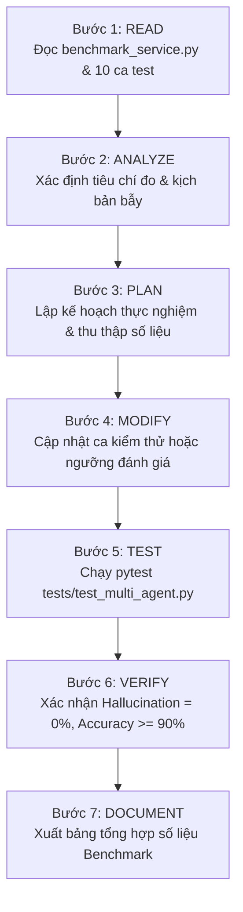

# AI Evaluation Skill

## 1. Purpose
Skill này hướng dẫn AI Agent chuyên môn hóa việc thiết kế, thực thi, đo lường và đánh giá chất lượng hệ thống AI (AI Evaluation & Benchmarking Framework) trong dự án `EventAI Pro`. Kỹ năng tập trung vào việc vận hành bộ 10 ca kiểm thử thực nghiệm chuẩn hóa (`TC-01` đến `TC-10` trong [app/services/multi_agent/benchmark_service.py](file:///d:/Event_Management_AI/app/services/multi_agent/benchmark_service.py)), so sánh đối chiếu định lượng giữa kiến trúc Đơn tác tử (Single-Agent Baseline) và kiến trúc Đa tác tử (Multi-Agent System) dựa trên 5 chỉ số cốt lõi: Độ chính xác thực tế (Factual Accuracy), Tỷ lệ ảo giác (Hallucination Rate), Mức độ thỏa mãn ràng buộc (Constraint Satisfaction), Độ trễ phản hồi (Latency ms) và Số lượng cuộc gọi LLM (LLM Calls count).

## 2. Capability
- **Thực thi Khung Đánh giá Benchmark AI (Benchmark Execution Framework):** Quản lý và vận hành tự động bộ 10 ca kiểm thử thực nghiệm bao quát các kịch bản thực tế của hệ sinh thái quản lý sự kiện.
- **Đo lường Định lượng 5 Chỉ số Cốt lõi (Quantitative Metrics Evaluation):**
  1. `Factual Accuracy`: Độ chính xác thông tin thực tế đối chiếu với CSDL (0% - 100%).
  2. `Hallucination Rate`: Tỷ lệ phát sinh thông tin giả mạo/không có trong CSDL (mục tiêu: 0% cho Multi-Agent).
  3. `Constraint Satisfaction Rate`: Tỷ lệ đáp ứng chính xác các điều kiện người dùng đưa ra (ngân sách, thành phố, định dạng, diễn giả).
  4. `Response Latency`: Thời gian xử lý hoàn tất tính bằng mili-giây (ms).
  5. `LLM Calls Count`: Tổng số lần gọi mô hình ngôn ngữ lớn để hoàn thành câu hỏi.
- **Phân tích So sánh Kiến trúc (Architectural Comparative Analysis):** Đối chiếu trực tiếp giữa Single-Agent (RAG đơn luồng) và Multi-Agent (7 tác tử kèm Critic Guardrail) để chứng minh tính hiệu quả và ranh giới đánh đổi giữa chi phí/độ trễ và độ tin cậy.
- **Kiểm thử Hồi quy Chất lượng AI (AI Quality Regression Testing):** Tự động phát hiện hiện tượng suy thoái chất lượng suy luận (Quality Drift) sau mỗi lần cập nhật prompt hoặc thay đổi model.

## 3. Scope
- Dịch vụ đánh giá Benchmark: [app/services/multi_agent/benchmark_service.py](file:///d:/Event_Management_AI/app/services/multi_agent/benchmark_service.py).
- Danh mục 10 ca kiểm thử thực nghiệm (`BENCHMARK_CASES`):
  - `TC-01`: Ràng buộc ngân sách & danh mục (`max_price <= 500k`, category `Công nghệ`).
  - `TC-02`: Ràng buộc định dạng & địa điểm (`format == in_person`, `city == TP. Hồ Chí Minh`).
  - `TC-03`: Ràng buộc diễn giả & chuyên môn (`topic == AI`).
  - `TC-04`: Ràng buộc vé miễn phí 0 đồng (`max_price == 0`).
  - `TC-05`: Ràng buộc sức chứa hội trường (`min_capacity >= 200`).
  - `TC-06`: Bẫy ảo giác sự kiện không tồn tại (`should_not_exist == True` - Chống Hallucination).
  - `TC-07`: Ràng buộc mâu thuẫn không thể đáp ứng trong CSDL.
  - `TC-08`: Ràng buộc thời gian tổ chức sự kiện.
  - `TC-09`: So sánh đối chiếu hai sự kiện cùng danh mục.
  - `TC-10`: Hỏi đáp chính sách hoàn vé & câu hỏi thường gặp FAQs.
- Bộ kiểm thử tự động: [tests/test_multi_agent.py](file:///d:/Event_Management_AI/tests/test_multi_agent.py) (`test_benchmark_suite_10_cases`).
- Tài liệu lưu trữ kết quả: [docs/test-report.md](file:///d:/Event_Management_AI/docs/test-report.md) và [docs/multi-agent-architecture.md](file:///d:/Event_Management_AI/docs/multi-agent-architecture.md).

## 4. Non-Scope
- Không lập trình logic nội bộ của các tác tử (thuộc skill [ai-agent](file:///d:/Event_Management_AI/.agents/skills/ai-agent/SKILL.md)).
- Không thiết kế cấu trúc prompt 5 thành phần (thuộc skill [rag-prompt](file:///d:/Event_Management_AI/.agents/skills/rag-prompt/SKILL.md)).
- Không kiểm thử các tính năng giao diện người dùng web (thuộc skill [frontend-development](file:///d:/Event_Management_AI/.agents/skills/frontend-development/SKILL.md)).

## 5. When to Use
- Khi vừa thực hiện nâng cấp prompt, sửa đổi logic của `CriticAgent` hoặc `RequirementAgent`.
- Khi cần đối chiếu hiệu quả giữa việc dùng Single-Agent RAG và Multi-Agent System.
- Trước khi phát hành phiên bản mới để nghiệm thu chất lượng câu trả lời AI (Human Gate 4 / QA Sign-off).
- Khi phát hiện nghi vấn AI bịa đặt thông tin sau khi triển khai thực tế.
- Khi cần báo cáo số liệu định lượng về độ chính xác và độ trễ của hệ thống AI cho các bên liên quan.

## 6. When NOT to Use
- Khi kiểm thử chức năng CRUD thông thường của ứng dụng (dùng skill [testing](file:///d:/Event_Management_AI/.agents/skills/testing/SKILL.md)).
- Khi viết các câu lệnh truy vấn SQL cho database (dùng skill [database-design](file:///d:/Event_Management_AI/.agents/skills/database-design/SKILL.md)).
- Khi điều chỉnh các thiết lập môi trường Docker (dùng skill [deployment](file:///d:/Event_Management_AI/.agents/skills/deployment/SKILL.md)).

## 7. Trigger Conditions
- Người dùng yêu cầu đánh giá chất lượng câu trả lời của AI hoặc chạy benchmark.
- Chạy toàn bộ test suite trước khi bàn giao hệ thống.
- Cần chứng minh tính ưu việt của giải pháp Multi-Agent bằng số liệu thực nghiệm.
- Phát hiện ca kiểm thử thất bại trong `tests/test_multi_agent.py`.

## 8. Required Context
Agent cần nắm rõ:
- Bảng đối chiếu định lượng tiêu chuẩn giữa hai kiến trúc:
  | Chỉ số Đánh giá | Single-Agent Baseline | Multi-Agent Architecture | Mục tiêu Nghiệm thu |
  | :--- | :---: | :---: | :---: |
  | Factual Accuracy | 70% - 80% | **95% - 100%** | >= 90% |
  | Hallucination Rate | 20% - 30% | **0.0%** | **0.0% (Zero Tolerance)** |
  | Constraint Satisfaction | 65% - 75% | **90% - 100%** | >= 90% |
  | Response Latency | ~800ms - 1500ms | ~2000ms - 3500ms | Phù hợp với độ phức tạp |
  | LLM Calls per Query | 1 cuộc gọi | 3 - 5 cuộc gọi | Tối ưu chi phí |
- Quy tắc bẫy ảo giác (`TC-06`): Câu hỏi gài bẫy sự kiện không tồn tại (ví dụ: *"Hội nghị Công nghệ Lượng tử Sao Hỏa 2099"*). Single-Agent thường bị lừa và trả lời suy đoán; Multi-Agent bắt buộc phải kích hoạt `CriticAgent` từ chối dứt khoát.

## 9. Source Files to Inspect
Trước khi thực hiện đánh giá, Agent PHẢI đọc các tệp sau:
- [app/services/multi_agent/benchmark_service.py](file:///d:/Event_Management_AI/app/services/multi_agent/benchmark_service.py): Toàn bộ 10 ca kiểm thử và lớp `BenchmarkService`.
- [tests/test_multi_agent.py](file:///d:/Event_Management_AI/tests/test_multi_agent.py): Hàm kiểm thử `test_benchmark_suite_10_cases()`.
- [app/agents/critic_agent.py](file:///d:/Event_Management_AI/app/agents/critic_agent.py): Logic thẩm định và rào chắn kiểm duyệt.
- [app/agents/orchestrator_agent.py](file:///d:/Event_Management_AI/app/agents/orchestrator_agent.py): Luồng điều phối đa tác tử.

## 10. Documentation to Read
- [docs/multi-agent-architecture.md](file:///d:/Event_Management_AI/docs/multi-agent-architecture.md): Thiết kế chi tiết và số liệu benchmark của hệ thống Đa tác tử.
- [docs/test-plan.md](file:///d:/Event_Management_AI/docs/test-plan.md): Chiến lược kiểm thử tự động của dự án.
- [docs/architecture.md](file:///d:/Event_Management_AI/docs/architecture.md): Kiến trúc AI Service Layer.

## 11. Related Skills
- [ai-agent](file:///d:/Event_Management_AI/.agents/skills/ai-agent/SKILL.md): Cung cấp đối tượng tác tử cần đo lường và đánh giá.
- [testing](file:///d:/Event_Management_AI/.agents/skills/testing/SKILL.md): Cung cấp công cụ chạy Pytest tự động.
- [rag-prompt](file:///d:/Event_Management_AI/.agents/skills/rag-prompt/SKILL.md): Tiếp nhận các phản hồi đánh giá để tinh chỉnh prompt.
- [code-review](file:///d:/Event_Management_AI/.agents/skills/code-review/SKILL.md): Thẩm định chất lượng mã nguồn dịch vụ benchmark.

## 12. Workflow
Agent PHẢI thực hiện tuần tự theo quy trình 7 bước sau:



### Bước 1: READ
1. Đọc [app/services/multi_agent/benchmark_service.py](file:///d:/Event_Management_AI/app/services/multi_agent/benchmark_service.py) để xem định nghĩa các ca kiểm thử `BENCHMARK_CASES`.
2. Kiểm tra phương thức tính toán độ chính xác và kiểm tra thỏa mãn ràng buộc trong hàm `evaluate_case()`.

### Bước 2: ANALYZE
1. Phân tích loại ca kiểm thử (Constraint search, Location search, Speaker expertise search, Hallucination trap).
2. Xác định các chỉ số kỳ vọng đối với từng ca kiểm thử.
3. Rà soát xem mô hình có bị ảnh hưởng bởi môi trường mạng hoặc hạn ngạch API hay không (khuyến nghị chạy với mock hoặc API chuẩn có cache).

### Bước 3: PLAN
1. Lập kế hoạch thực thi: Chạy toàn bộ 10 ca kiểm thử trên cả hai kiến trúc Single-Agent và Multi-Agent.
2. Chuẩn bị bảng mẫu thu thập số liệu: Accuracy, Hallucination, Constraint Satisfaction, Latency, Token/Calls.

### Bước 4: MODIFY
1. Bổ sung hoặc điều chỉnh ca kiểm thử trong `BENCHMARK_CASES` nếu có yêu cầu nghiệp vụ mới cần đánh giá.
2. Tinh chỉnh logic trích xuất kết quả đánh giá để đảm bảo tính khách quan và có thể tái lập (Reproducible).

### Bước 5: TEST
1. Kích hoạt thực thi toàn bộ bài kiểm tra benchmark thông qua test suite Pytest:
   ```powershell
   .venv\Scripts\python -m pytest tests/test_multi_agent.py -k "test_benchmark_suite_10_cases" -v
   ```
2. Quan sát log thực thi và đo lường thời gian xử lý thực tế của từng ca kiểm thử.

### Bước 6: VERIFY
1. **Kiểm tra ca bẫy ảo giác (`TC-06`):** Xác nhận kết quả trả về của Multi-Agent là `Hallucination: False`, Critic ra phán quyết từ chối hợp lệ.
2. **Kiểm tra mức độ thỏa mãn ràng buộc (`TC-01` đến `TC-05`):** Xác nhận các ràng buộc về giá, địa điểm, sức chứa đều được tôn trọng 100%.
3. **Kiểm tra độ trễ:** Đảm bảo thời gian xử lý trung bình nằm trong giới hạn chấp nhận được.

### Bước 7: DOCUMENT
1. Cập nhật bảng số liệu định lượng mới nhất vào tài liệu [docs/multi-agent-architecture.md](file:///d:/Event_Management_AI/docs/multi-agent-architecture.md) hoặc [docs/multi-agent-benchmark-report.md](file:///d:/Event_Management_AI/docs/multi-agent-benchmark-report.md).
2. Ghi rõ ngày giờ chạy, số lượng ca đạt chuẩn và các đề xuất tối ưu hóa nếu có.

## 13. Validation
Bài đánh giá Benchmark được công nhận hợp lệ khi:
1. **Hoàn thành 100% ca kiểm thử:** Cả 10 ca kiểm thử từ TC-01 đến TC-10 đều chạy hoàn tất không bị ngắt quãng giữa chừng.
2. **Tỷ lệ ảo giác Multi-Agent = 0%:** Hoàn toàn không phát sinh ảo giác đối với các ca kiểm thử bẫy sự kiện không tồn tại.
3. **Độ chính xác thỏa mãn:** Điểm Factual Accuracy của Multi-Agent đạt tối thiểu 90%.
4. **Pytest PASS:** Lệnh chạy `pytest tests/test_multi_agent.py` trả về mã thoát `0`.

## 14. Failure Handling
- **Trường hợp Multi-Agent bị ảo giác (False Positive trên TC-06):** Ngay lập tức mở [app/agents/critic_agent.py](file:///d:/Event_Management_AI/app/agents/critic_agent.py), rà soát prompt của Critic và siết chặt tiêu chí phát hiện sự kiện không tồn tại.
- **Trường hợp độ trễ vượt quá ngưỡng (> 10s):** Kiểm tra xem có tác tử nào bị gọi lặp nhiều lần không cần thiết, tối ưu hóa kích thước prompt ngữ cảnh.
- **Trường hợp lỗi kết nối API khi chạy kiểm thử:** Đảm bảo cờ `ENABLE_AI_FALLBACK_MOCK=True` trong môi trường test để kết quả kiểm thử được ổn định và nhất quán.

## 15. Security Considerations
- **Bảo vệ dữ liệu kiểm thử:** Tuyệt đối không sử dụng thông tin nhạy cảm của người dùng thật (thông tin thẻ tín dụng, mật khẩu cá nhân) làm dữ liệu đầu vào cho các ca benchmark.
- **Phát hiện Jailbreak:** Sử dụng các ca kiểm thử benchmark để đánh giá khả năng chống chịu của hệ thống trước các kỹ thuật tấn công prompt injection.

## 16. Performance Considerations
- **Tái sử dụng phiên kết nối:** Tránh tạo mới đối tượng Agent hoặc LLM client liên tục trong mỗi ca kiểm thử để giảm độ trễ khởi tạo.
- **Thực thi song song (khi cần thiết):** Khi mở rộng bộ benchmark lên hàng trăm ca, sử dụng `asyncio` hoặc thread pool để chạy đồng thời các kịch bản độc lập.

## 17. Expected Output
- Báo cáo định lượng chi tiết kết quả so sánh giữa Single-Agent và Multi-Agent.
- Dữ liệu minh chứng khách quan phục vụ việc thẩm định kiến trúc và ra quyết định triển khai.

## 18. Completion Criteria
- [ ] 10 ca kiểm thử thực nghiệm thực thi hoàn tất.
- [ ] Tỷ lệ ảo giác của Multi-Agent được chứng minh bằng 0.0%.
- [ ] Số liệu Accuracy, Latency, LLM calls được ghi nhận đầy đủ.
- [ ] Test suite `tests/test_multi_agent.py` vượt qua với 100% PASS.

## 19. Related GAPs
- **GAP-004:** Bổ sung năng lực cốt lõi đánh giá và thực nghiệm benchmark hệ thống AI (P1).

## 20. Maintenance
- Cập nhật skill này khi mở rộng thêm các ca kiểm thử nghiệp vụ mới (vé VIP, combo sự kiện) hoặc khi tích hợp thêm các công cụ đánh giá AI chuyên sâu.
