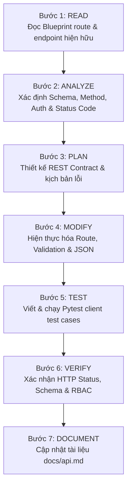

# API Development Skill

## 1. Purpose
Skill này hướng dẫn AI Agent chuyên môn hóa việc thiết kế, chuẩn hóa, hiện thực hóa và kiểm thử toàn bộ hệ thống API (RESTful API Contracts) trong dự án `EventAI Pro`. Kỹ năng đặt trọng tâm vào việc xây dựng các giao diện lập trình ứng dụng (API endpoints) nhất quán, chuẩn hóa cấu trúc dữ liệu JSON phản hồi (Response Schema), quản lý mã trạng thái HTTP chuẩn xác (HTTP Status Codes), kiểm duyệt chặt chẽ dữ liệu đầu vào (Input Validation & Sanitization), phân quyền truy cập theo vai trò (RBAC), và ngăn ngừa rò rỉ dữ liệu nhạy cảm hoặc lỗi máy chủ (500 Internal Server Error).

## 2. Capability
- **Thiết kế & Quản trị Hợp đồng RESTful API (API Contract Design):** Thiết kế đường dẫn định danh tài nguyên chuẩn REST (`/api/v1/...`, `/events/<id>`, `/checkin/verify-api`), phương thức HTTP ngữ nghĩa (`GET`, `POST`, `PUT`, `DELETE`).
- **Chuẩn hóa Cấu trúc Dữ liệu JSON (Unified JSON Schema):**
  - Trạng thái thành công: `{"success": true, "data": {...}, "message": "Thông điệp thành công"}`
  - Trạng thái thất bại: `{"success": false, "error": "Chi tiết lỗi thân thiện", "code": "MÃ_LỖI_CHUẨN"}`
- **Quản trị Mã Trạng thái HTTP (HTTP Status Code Management):**
  - `200 OK`: Truy vấn thành công hoặc cập nhật hoàn tất.
  - `201 Created`: Tạo mới tài nguyên thành công (đăng ký vé, tạo sự kiện).
  - `400 Bad Request`: Payload JSON không đúng định dạng hoặc thiếu trường bắt buộc.
  - `401 Unauthorized`: Chưa đăng nhập hoặc phiên làm việc hết hạn.
  - `403 Forbidden`: Người dùng đã đăng nhập nhưng không đủ quyền (RBAC).
  - `404 Not Found`: Tài nguyên không tồn tại trong cơ sở dữ liệu.
  - `409 Conflict`: Xung đột dữ liệu (vé đã được sử dụng trước đó, trùng lịch).
  - `422 Unprocessable Entity`: Dữ liệu vi phạm ràng buộc nghiệp vụ.
  - `429 Too Many Requests`: Vượt quá tần suất yêu cầu cho phép (Rate Limiting).
  - `500 Internal Server Error`: Lỗi ngoại lệ nội bộ máy chủ đã được bọc an toàn.
- **Bảo mật & Phân quyền RBAC (Role-Based Access Control):** Xác thực định danh người dùng qua phiên làm việc (`@login_required`) và kiểm soát vai trò (`admin`, `organizer`, `staff`, `attendee`).
- **Phân trang & Lọc Dữ liệu (Pagination & Filtering):** Hỗ trợ chuẩn các tham số truy vấn `page`, `per_page`, `q`, `category`, `status`.

## 3. Scope
- Toàn bộ 66 API endpoints trong 8 Blueprints của ứng dụng:
  - Phân hệ Xác thực: [app/routes/auth.py](file:///d:/Event_Management_AI/app/routes/auth.py)
  - Phân hệ Sự kiện: [app/routes/events.py](file:///d:/Event_Management_AI/app/routes/events.py)
  - Phân hệ Đặt vé: [app/routes/tickets.py](file:///d:/Event_Management_AI/app/routes/tickets.py)
  - Phân hệ Điểm danh QR: [app/routes/checkin.py](file:///d:/Event_Management_AI/app/routes/checkin.py)
  - Phân hệ Quản trị: [app/routes/admin.py](file:///d:/Event_Management_AI/app/routes/admin.py)
  - Phân hệ Trợ lý AI: [app/routes/ai.py](file:///d:/Event_Management_AI/app/routes/ai.py)
  - Phân hệ Thông báo: [app/routes/notifications.py](file:///d:/Event_Management_AI/app/routes/notifications.py)
  - Phân hệ Trang chủ: [app/routes/main.py](file:///d:/Event_Management_AI/app/routes/main.py)
- Tài liệu đặc tả API: [docs/api.md](file:///d:/Event_Management_AI/docs/api.md).

## 4. Non-Scope
- Không lập trình giao diện người dùng HTML/Jinja2 (thuộc skill [frontend-development](file:///d:/Event_Management_AI/.agents/skills/frontend-development/SKILL.md)).
- Không thiết kế lược đồ bảng CSDL và chỉ mục Index (thuộc skill [database-design](file:///d:/Event_Management_AI/.agents/skills/database-design/SKILL.md)).
- Không can thiệp vào quy trình đóng gói container Docker (thuộc skill [deployment](file:///d:/Event_Management_AI/.agents/skills/deployment/SKILL.md)).

## 5. When to Use
- Khi thêm mới một endpoint API phục vụ cho giao diện web hoặc ứng dụng di động bên ngoài.
- Khi điều chỉnh payload JSON request hoặc mở rộng response data của endpoint sẵn có.
- Khi phát hiện endpoint trả về mã lỗi HTTP sai ngữ nghĩa (ví dụ: trả về HTTP 200 kèm `{"error": "not found"}` thay vì HTTP 404).
- Khi endpoint API thiếu kiểm tra phân quyền RBAC hoặc thiếu kiểm duyệt dữ liệu đầu vào.
- Khi đồng bộ hóa tài liệu [docs/api.md](file:///d:/Event_Management_AI/docs/api.md) với các endpoints thực tế.

## 6. When NOT to Use
- Khi tạo route đơn thuần chỉ để render Jinja2 HTML không trả về JSON (dùng skill [implementation](file:///d:/Event_Management_AI/.agents/skills/implementation/SKILL.md) và [frontend-development](file:///d:/Event_Management_AI/.agents/skills/frontend-development/SKILL.md)).
- Khi viết prompt cho mô hình Gemini (dùng skill [rag-prompt](file:///d:/Event_Management_AI/.agents/skills/rag-prompt/SKILL.md)).
- Khi thực thi các bài kiểm thử benchmark hiệu năng AI (dùng skill [ai-evaluation](file:///d:/Event_Management_AI/.agents/skills/ai-evaluation/SKILL.md)).

## 7. Trigger Conditions
- Người dùng yêu cầu tạo mới hoặc sửa đổi endpoint RESTful.
- Endpoint trả về lỗi 500 văng traceback do thiếu kiểm tra ngoại lệ `KeyError` hoặc `ValueError`.
- Client frontend gửi `fetch()` nhận được phản hồi không có header `Content-Type: application/json`.
- Cần mở rộng API cho ứng dụng di động quét mã QR hoặc ứng dụng thứ ba tích hợp.

## 8. Required Context
Agent cần nắm rõ:
- Cấu trúc Response chuẩn của dự án:
  ```python
  from flask import jsonify
  return jsonify({
      "success": True,
      "data": result_data,
      "message": "Thao tác thành công"
  }), 200
  ```
- Thư viện xác thực phiên người dùng `flask_login`: `current_user.is_authenticated`, `current_user.role`.
- Hàm kiểm tra CSRF token và rate limit tích hợp trong service AI: [app/services/gemini_service.py](file:///d:/Event_Management_AI/app/services/gemini_service.py).

## 9. Source Files to Inspect
Trước khi phát triển hoặc sửa đổi API, Agent PHẢI đọc các tệp sau:
- [app/routes/events.py](file:///d:/Event_Management_AI/app/routes/events.py): Các endpoint danh sách, chi tiết sự kiện và tìm kiếm.
- [app/routes/tickets.py](file:///d:/Event_Management_AI/app/routes/tickets.py): Các endpoint đặt vé, xem vé, hủy vé.
- [app/routes/checkin.py](file:///d:/Event_Management_AI/app/routes/checkin.py): Endpoint API xác thực vé `/checkin/verify-api`.
- [app/routes/ai.py](file:///d:/Event_Management_AI/app/routes/ai.py): Các endpoint đối thoại AI `/ai/chat`, `/ai/feedback`, `/ai/clear-history`.
- [app/routes/notifications.py](file:///d:/Event_Management_AI/app/routes/notifications.py): Endpoint đọc và đếm thông báo chưa đọc.
- [app/routes/admin.py](file:///d:/Event_Management_AI/app/routes/admin.py): Các endpoint quản trị hệ thống, báo cáo thống kê.

## 10. Documentation to Read
- [docs/api.md](file:///d:/Event_Management_AI/docs/api.md): Tài liệu đặc tả API chính thức của dự án.
- [docs/architecture.md](file:///d:/Event_Management_AI/docs/architecture.md): Thiết kế tổng thể hệ thống 3 tầng.
- [docs/security-review.md](file:///d:/Event_Management_AI/docs/security-review.md): Tiêu chuẩn an ninh phân quyền RBAC và kiểm soát dữ liệu.

## 11. Related Skills
- [implementation](file:///d:/Event_Management_AI/.agents/skills/implementation/SKILL.md): Viết mã controller và dịch vụ nghiệp vụ cơ sở.
- [security-review](file:///d:/Event_Management_AI/.agents/skills/security-review/SKILL.md): Đánh giá an toàn API theo tiêu chuẩn OWASP API Security Top 10.
- [testing](file:///d:/Event_Management_AI/.agents/skills/testing/SKILL.md): Viết các test case tự động kiểm thử endpoint.
- [frontend-development](file:///d:/Event_Management_AI/.agents/skills/frontend-development/SKILL.md): Gọi API từ giao diện người dùng.

## 12. Workflow
Agent PHẢI thực hiện tuần tự theo quy trình 7 bước sau:



### Bước 1: READ
1. Đọc tệp Blueprint tương ứng trong [app/routes/](file:///d:/Event_Management_AI/app/routes/).
2. Xác định các decorator đang bảo vệ endpoint (`@login_required`, `@roles_accepted`).
3. Kiểm tra xem route hiện tại đã tồn tại trong `docs/api.md` hay chưa.

### Bước 2: ANALYZE
1. Phân tích tham số đầu vào:
   - URL Path Parameters (ví dụ: `/events/<int:event_id>`).
   - Query Parameters (ví dụ: `?page=1&per_page=10&status=published`).
   - Request Body JSON (ví dụ: `{"ticket_id": 1, "code": "..."}`).
2. Rà soát ma trận quyền RBAC: Ai được gọi endpoint này? Khách vãng lai (`anonymous`), Khách tham dự (`attendee`), Nhân viên (`staff`), hay Quản trị viên (`admin`)?
3. Xác định toàn bộ các mã phản hồi HTTP có thể phát sinh.

### Bước 3: PLAN
1. Lập hợp đồng giao tiếp (API Contract): Định nghĩa rõ JSON Request Body và JSON Response Body cho cả trường hợp 200, 400, 403, 404.
2. Thiết kế hàm kiểm tra tính hợp lệ dữ liệu đầu vào: Bắt buộc kiểu số, giới hạn độ dài chuỗi, kiểm tra định dạng email hoặc ngày tháng.
3. Lên danh sách các ca kiểm thử tự động (Test Cases) cần viết cho endpoint.

### Bước 4: MODIFY
1. Hiện thực hóa mã nguồn endpoint trong Blueprint:
   ```python
   @bp.route('/api/endpoint', methods=['POST'])
   @login_required
   def my_api_endpoint():
       data = request.get_json()
       if not data:
           return jsonify({"success": False, "error": "Thiếu dữ liệu payload JSON", "code": "MISSING_PAYLOAD"}), 400
       
       # Validate fields
       required_fields = ['name', 'amount']
       for field in required_fields:
           if field not in data:
               return jsonify({"success": False, "error": f"Thiếu trường bắt buộc: {field}", "code": "VALIDATION_ERROR"}), 400
       
       try:
           # Execute business logic
           result = execute_business_logic(data)
           return jsonify({"success": True, "data": result, "message": "Thành công"}), 200
       except BusinessException as e:
           return jsonify({"success": False, "error": str(e), "code": "BUSINESS_ERROR"}), 422
       except Exception as e:
           # Log internal error safely
           return jsonify({"success": False, "error": "Lỗi hệ thống nội bộ", "code": "SERVER_ERROR"}), 500
   ```

### Bước 5: TEST
1. Sử dụng Flask Test Client trong Pytest để kiểm tra toàn bộ luồng:
   - Gọi endpoint thành công -> HTTP 200/201.
   - Gọi không truyền body -> HTTP 400.
   - Người dùng chưa đăng nhập gọi endpoint -> HTTP 401/302 Redirect.
   - Người dùng sai vai trò gọi endpoint -> HTTP 403.
2. Chạy lệnh kiểm thử tự động:
   ```powershell
   .venv\Scripts\python -m pytest tests/test_events.py tests/test_tickets.py tests/test_checkin.py -v
   ```

### Bước 6: VERIFY
1. Xác nhận phản hồi luôn chứa header `Content-Type: application/json`.
2. Kiểm tra tính bảo mật: Không có mật khẩu, secret key, hoặc stack trace nhạy cảm bị rò rỉ trong JSON response.
3. Xác nhận tính tương thích ngược (Backward Compatibility) với các client hiện hữu.

### Bước 7: DOCUMENT
1. Cập nhật endpoint mới hoặc các thay đổi vào [docs/api.md](file:///d:/Event_Management_AI/docs/api.md).
2. Ghi rõ: Method, URL, Header, Body Parameters, Response Example (200 & Error).

## 13. Validation
Endpoint API được nghiệm thu khi thỏa mãn:
1. **Chuẩn mã HTTP:** Trả về đúng mã HTTP ngữ nghĩa (không bao giờ trả HTTP 200 khi có lỗi).
2. **Schema đồng nhất:** 100% phản hồi có thuộc tính `success: true/false`.
3. **Phân quyền chặt chẽ:** Kiểm tra thử nghiệm bằng user không đủ quyền trả về đúng HTTP 403 Forbidden.
4. **Không rò rỉ Stacktrace:** Mọi lỗi 500 đều được bọc trong cấu trúc JSON thân thiện.
5. **Đầy đủ Unit/Integration Test:** Có tối thiểu 1 test case tích hợp thành công và 1 test case bắt lỗi.

## 14. Failure Handling
- **Trường hợp client gửi Content-Type sai:** Xử lý `request.get_json(silent=True)` để trả về HTTP 400 thay vì phát sinh ngoại lệ 500 `BadRequest`.
- **Trường hợp xung đột dữ liệu (IntegrityError):** Bắt ngoại lệ `sqlalchemy.exc.IntegrityError`, gọi `db.session.rollback()` và trả về HTTP 409 Conflict.
- **Trường hợp tài nguyên không tìm thấy:** Sử dụng `db.session.get(Model, id)` hoặc xử lý 404 tường minh trả về JSON rõ ràng.

## 15. Security Considerations
- **Kiểm soát xác thực (Authentication):** Luôn gắn `@login_required` cho các endpoint thao tác dữ liệu cá nhân hoặc quản trị.
- **Kiểm tra quyền sở hữu (IDOR Prevention):** Luôn kiểm tra xem vé hoặc sự kiện có thuộc về người dùng đang đăng nhập hay không trước khi cập nhật hoặc hủy.
- **Giới hạn tốc độ (Rate Limiting):** Áp dụng rate limiting đối với các endpoint tốn tài nguyên (đặc biệt là `/ai/chat` và `/checkin/verify-api`).

## 16. Performance Considerations
- **Tối ưu truy vấn CSDL:** Chỉ truy vấn các cột cần thiết, áp dụng `db.joinedload` nếu cần lấy dữ liệu quan hệ, tránh lỗi truy vấn lặp N+1.
- **Payload kích thước hợp lý:** Luôn sử dụng phân trang (`page`, `per_page`) đối với các danh sách lớn, giới hạn `per_page <= 50`.

## 17. Expected Output
- Endpoint API chuẩn RESTful, an toàn, ổn định.
- Bộ test suite Pytest bao phủ các nhánh kịch bản của endpoint.
- Mục tài liệu cập nhật trong `docs/api.md` mô tả đầy đủ thông số kỹ thuật.

## 18. Completion Criteria
- [ ] Endpoint xử lý đúng phương thức HTTP được khai báo.
- [ ] Dữ liệu đầu vào được validate và sanitize đầy đủ.
- [ ] Chuẩn hóa payload trả về theo schema chung của dự án.
- [ ] Phân quyền RBAC hoạt động chính xác.
- [ ] Test cases Pytest vượt qua 100%.

## 19. Related GAPs
- **GAP-004:** Bổ sung năng lực cốt lõi phát triển và quản trị RESTful API (P1).
- **GAP-005:** Đồng bộ hóa tài liệu đặc tả 66 endpoints thực tế vào tài liệu API.

## 20. Maintenance
- Cập nhật skill này khi dự án chuyển đổi sang kiến trúc Microservices hoặc áp dụng cơ chế xác thực Token OAuth2/JWT.
