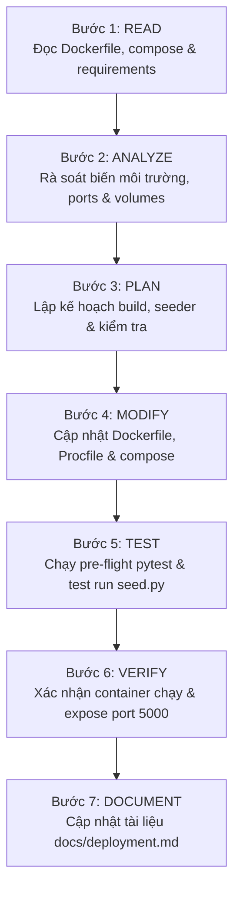

# Deployment Skill

## 1. Purpose
Skill này hướng dẫn AI Agent chuyên môn hóa việc đóng gói, cấu hình môi trường, khởi tạo cơ sở dữ liệu mẫu, vận hành và triển khai ứng dụng `EventAI Pro` trên môi trường Container hóa (Docker, Docker Compose) và máy chủ sản xuất (Gunicorn WSGI / Cloud PaaS). Kỹ năng tập trung vào việc quản lý cấu hình tệp [Dockerfile](file:///d:/Event_Management_AI/Dockerfile), điều phối dịch vụ với [docker-compose.yml](file:///d:/Event_Management_AI/docker-compose.yml), thiết lập máy chủ WSGI hiệu năng cao qua [Procfile](file:///d:/Event_Management_AI/Procfile), quản trị biến môi trường bảo mật qua `.env.example`, thực thi kịch bản nạp dữ liệu mẫu [seed.py](file:///d:/Event_Management_AI/seed.py), duy trì tính bền vững của dữ liệu tải lên và mã QR qua Docker Volumes, cùng quy trình kiểm tra sức khỏe và rollback an toàn.

## 2. Capability
- **Đóng gói Ứng dụng Container (Containerization & Image Build):** Xây dựng và tối ưu hóa Docker Image dựa trên `python:3.12-slim`, tận dụng bộ nhớ đệm (Layer Caching) bằng cách cài đặt `requirements.txt` trước khi sao chép mã nguồn.
- **Điều phối Dịch vụ Cục bộ (Local Service Orchestration):** Cấu hình [docker-compose.yml](file:///d:/Event_Management_AI/docker-compose.yml) với đầy đủ định danh container (`event_mgmt_ai_app`), chuyển tiếp cổng mạng (`5000:5000`), chính sách tự khởi động lại (`restart: unless-stopped`) và gắn kết ổ đĩa bền vững (Volume Persistence).
- **Cấu hình Máy chủ Sản xuất WSGI (Production WSGI Server Configuration):** Thiết lập thông số vận hành Gunicorn trong [Procfile](file:///d:/Event_Management_AI/Procfile) (`2 workers`, `4 threads`, `timeout 120s`) phù hợp cho các nền tảng Cloud PaaS (Heroku, Render, Railway, Google Cloud Run).
- **Quản trị Biến Môi trường An toàn (Environment Variables Management):** Chuẩn hóa việc nạp cấu hình qua `.env` và [app/config.py](file:///d:/Event_Management_AI/app/config.py): `FLASK_ENV`, `SECRET_KEY`, `DATABASE_URI`, `GEMINI_API_KEY`, `GEMINI_MODEL`, `ENABLE_AI_FALLBACK_MOCK`.
- **Khởi tạo & Đồng bộ Dữ liệu Ban đầu (Database Seeding & Migration):** Vận hành tự động kịch bản [seed.py](file:///d:/Event_Management_AI/seed.py) để khởi tạo 11 bảng CSDL 3NF và nạp đầy đủ dữ liệu mẫu (sự kiện, vé, tài khoản quản trị/nhân viên, câu hỏi thường gặp).
- **Kiểm tra Sức khỏe & Điều kiện Tiên quyết (Pre-flight & Health Checks):** Xác nhận toàn bộ 36 ca kiểm thử tự động vượt qua trước khi build image và kiểm tra cổng dịch vụ sau khi container khởi chạy.

## 3. Scope
- Tệp cấu hình đóng gói: [Dockerfile](file:///d:/Event_Management_AI/Dockerfile).
- Tệp điều phối container: [docker-compose.yml](file:///d:/Event_Management_AI/docker-compose.yml).
- Tệp cấu hình máy chủ Web WSGI: [Procfile](file:///d:/Event_Management_AI/Procfile).
- Danh mục thư viện phụ thuộc: [requirements.txt](file:///d:/Event_Management_AI/requirements.txt).
- Tệp mẫu biến môi trường: `.env.example`.
- Điểm khởi chạy ứng dụng: [run.py](file:///d:/Event_Management_AI/run.py) và [app/config.py](file:///d:/Event_Management_AI/app/config.py).
- Kịch bản nạp dữ liệu: [seed.py](file:///d:/Event_Management_AI/seed.py).
- Thư mục dữ liệu cần ánh xạ volume: `app/static/qr_codes/` và `app/static/uploads/`.
- Tài liệu hướng dẫn triển khai: [docs/deployment.md](file:///d:/Event_Management_AI/docs/deployment.md).

## 4. Non-Scope
- Không lập trình logic chức năng trong các controller Flask (thuộc skill [implementation](file:///d:/Event_Management_AI/.agents/skills/implementation/SKILL.md)).
- Không thiết kế cấu trúc RESTful API (thuộc skill [api-development](file:///d:/Event_Management_AI/.agents/skills/api-development/SKILL.md)).
- Không can thiệp vào mô hình phân rã Đa tác tử AI (thuộc skill [ai-agent](file:///d:/Event_Management_AI/.agents/skills/ai-agent/SKILL.md)).

## 5. When to Use
- Khi chuẩn bị đóng gói phần mềm để bàn giao hoặc chạy thử nghiệm trên máy tính khác hoặc máy chủ staging/production.
- Khi cần cập nhật danh mục thư viện phụ thuộc trong `requirements.txt`.
- Khi thay đổi cấu hình cổng mạng, số lượng Gunicorn workers, hoặc cấu hình timeout.
- Khi cần chạy lại kịch bản nạp dữ liệu mẫu ban đầu để phục hồi môi trường sạch.
- Khi kiểm tra an toàn biến môi trường và phát hiện rò rỉ secret key trong mã nguồn.

## 6. When NOT to Use
- Khi đang viết code giao diện CSS/Jinja2 (dùng skill [frontend-development](file:///d:/Event_Management_AI/.agents/skills/frontend-development/SKILL.md)).
- Khi phân tích yêu cầu từ khách hàng (dùng skill [requirements-analysis](file:///d:/Event_Management_AI/.agents/skills/requirements-analysis/SKILL.md)).
- Khi rà soát mã nguồn tìm lỗi bảo mật OWASP trong code logic (dùng skill [security-review](file:///d:/Event_Management_AI/.agents/skills/security-review/SKILL.md)).

## 7. Trigger Conditions
- Người dùng yêu cầu hướng dẫn build Docker hoặc chạy `docker-compose`.
- Container không khởi động được hoặc bị thoát ngay sau khi chạy (`Exited with code 1`).
- Lỗi kết nối CSDL trong container do thiếu quyền ghi volume (`sqlite3.OperationalError: unable to open database file`).
- Chuẩn bị bước nghiệm thu triển khai hệ thống (Human Gate 5 / Release).

## 8. Required Context
Agent cần nắm rõ:
- Cấu hình tiêu chuẩn của Dockerfile:
  ```dockerfile
  FROM python:3.12-slim
  WORKDIR /app
  ENV PYTHONDONTWRITEBYTECODE=1 PYTHONUNBUFFERED=1 FLASK_ENV=production PORT=5000
  RUN apt-get update && apt-get install -y --no-install-recommends build-essential && rm -rf /var/lib/apt/lists/*
  COPY requirements.txt .
  RUN pip install --no-cache-dir -r requirements.txt
  COPY . .
  RUN python seed.py
  EXPOSE 5000
  CMD ["python", "run.py"]
  ```
- Danh mục biến môi trường cốt lõi:
  - `FLASK_ENV`: `production` hoặc `development`.
  - `SECRET_KEY`: Khóa mã hóa session người dùng (bắt buộc phải là chuỗi ngẫu nhiên dài).
  - `DATABASE_URI`: Chuỗi kết nối CSDL (mặc định `sqlite:///event_management.db`).
  - `GEMINI_API_KEY`: Khóa API Google AI Studio (được nạp từ môi trường máy chủ).
  - `ENABLE_AI_FALLBACK_MOCK`: `True` cho phép chuyển sang mock dữ liệu mẫu nếu API key hết hạn hoặc mất mạng.
- Dữ liệu tài khoản mặc định nạp từ `seed.py`:
  - Quản trị viên: `admin@eventai.vn` / `Admin@123`
  - Ban tổ chức: `organizer@eventai.vn` / `Organizer@123`
  - Nhân viên soát vé: `staff@eventai.vn` / `Staff@123`
  - Người tham dự: `attendee@eventai.vn` / `Attendee@123`

## 9. Source Files to Inspect
Trước khi triển khai hoặc chỉnh sửa cấu hình, Agent PHẢI đọc các tệp sau:
- [Dockerfile](file:///d:/Event_Management_AI/Dockerfile): Định nghĩa các bước build container.
- [docker-compose.yml](file:///d:/Event_Management_AI/docker-compose.yml): Cấu hình cổng, biến môi trường và volume gắn kết.
- [Procfile](file:///d:/Event_Management_AI/Procfile): Cấu hình lệnh khởi chạy Gunicorn trên cloud.
- [requirements.txt](file:///d:/Event_Management_AI/requirements.txt): Toàn bộ các gói thư viện Python cần cài đặt.
- [run.py](file:///d:/Event_Management_AI/run.py): Điểm khởi chạy Flask server.
- [app/config.py](file:///d:/Event_Management_AI/app/config.py): Cơ chế đọc cấu hình từ môi trường hệ thống.
- [seed.py](file:///d:/Event_Management_AI/seed.py): Kịch bản nạp dữ liệu ban đầu.

## 10. Documentation to Read
- [docs/deployment.md](file:///d:/Event_Management_AI/docs/deployment.md): Tài liệu hướng dẫn triển khai chính thức của dự án.
- [docs/architecture.md](file:///d:/Event_Management_AI/docs/architecture.md): Kiến trúc hạ tầng hệ thống.
- [docs/security-review.md](file:///d:/Event_Management_AI/docs/security-review.md): Quy chuẩn bảo mật biến môi trường và thông tin đăng nhập.

## 11. Related Skills
- [testing](file:///d:/Event_Management_AI/.agents/skills/testing/SKILL.md): Đảm bảo 100% test cases vượt qua trước khi kích hoạt quy trình triển khai.
- [security-review](file:///d:/Event_Management_AI/.agents/skills/security-review/SKILL.md): Kiểm toán bảo mật Dockerfile và các cấu hình nhạy cảm.
- [database-design](file:///d:/Event_Management_AI/.agents/skills/database-design/SKILL.md): Đồng bộ lược đồ CSDL và kịch bản `seed.py`.
- [documentation](file:///d:/Event_Management_AI/.agents/skills/documentation/SKILL.md): Cập nhật nhật ký phát hành và hướng dẫn vận hành.

## 12. Workflow
Agent PHẢI thực hiện tuần tự theo quy trình 7 bước sau:



### Bước 1: READ
1. Đọc [Dockerfile](file:///d:/Event_Management_AI/Dockerfile), [docker-compose.yml](file:///d:/Event_Management_AI/docker-compose.yml), và [Procfile](file:///d:/Event_Management_AI/Procfile).
2. Kiểm tra danh mục gói trong [requirements.txt](file:///d:/Event_Management_AI/requirements.txt) để phát hiện gói bị thiếu hoặc xung đột phiên bản.
3. Rà soát [app/config.py](file:///d:/Event_Management_AI/app/config.py) để nắm danh sách biến môi trường bắt buộc.

### Bước 2: ANALYZE
1. Kiểm tra an toàn bảo mật: Tuyệt đối không để lộ `GEMINI_API_KEY` hoặc `SECRET_KEY` thật trong Dockerfile hoặc mã nguồn được đẩy lên repository.
2. Kiểm tra tính liên tục của dữ liệu: Đảm bảo các thư mục chứa ảnh tải lên (`app/static/uploads`) và mã QR (`app/static/qr_codes`) được khai báo ánh xạ trong khối `volumes:` của `docker-compose.yml`.
3. Kiểm tra số lượng workers và threads: Với môi trường 2GB RAM tiêu chuẩn, 2 workers và 4 threads của Gunicorn là cấu hình tối ưu.

### Bước 3: PLAN
1. Lập danh sách các bước chuẩn bị (Pre-flight): Chạy toàn bộ test suite Pytest.
2. Xác định các lệnh cần thực thi: Build image, khởi chạy container, kiểm tra cổng mạng, kiểm tra dữ liệu mẫu.

### Bước 4: MODIFY
1. Bổ sung hoặc điều chỉnh cấu hình trong Dockerfile hoặc docker-compose.yml nếu cần thêm biến môi trường hoặc thư mục volume mới.
2. Cập nhật `requirements.txt` nếu có thư viện mới được thêm vào ứng dụng.
3. Đảm bảo [seed.py](file:///d:/Event_Management_AI/seed.py) được cấu hình chạy tự động trong Dockerfile để container sẵn sàng sử dụng ngay sau khi build.

### Bước 5: TEST
1. Chạy bài kiểm tra tự động Pre-flight để bảo đảm chất lượng mã nguồn trước khi build:
   ```powershell
   .venv\Scripts\python -m pytest -v
   ```
2. Thử nghiệm chạy kịch bản nạp dữ liệu mẫu cục bộ để kiểm tra tính toàn vẹn của database:
   ```powershell
   .venv\Scripts\python seed.py
   ```

### Bước 6: VERIFY
1. Kiểm tra cú pháp hợp lệ của Dockerfile và docker-compose:
   - File cấu hình không có lỗi thụt dòng YAML hoặc lệnh sai cú pháp.
2. Xác nhận cổng mạng: Cổng `5000` được mở và ứng dụng lắng nghe trên tất cả các địa chỉ giao diện mạng (`0.0.0.0:5000`).
3. Xác nhận tính bền bỉ: Thư mục volume lưu trữ mã QR không bị ghi đè hay mất dữ liệu khi restart container.

### Bước 7: DOCUMENT
1. Cập nhật các thay đổi về cổng, biến môi trường hoặc lệnh chạy vào [docs/deployment.md](file:///d:/Event_Management_AI/docs/deployment.md).
2. Ghi chú quy trình thiết lập môi trường cho lập trình viên mới.

## 13. Validation
Quá trình đóng gói và triển khai đạt chuẩn khi:
1. **Build Container Thành công:** Lệnh `docker build -t event-ai-pro .` hoàn thành không lỗi.
2. **Khởi chạy Dịch vụ Ổn định:** Lệnh `docker compose up -d` khởi động container ở trạng thái `Up` (healthy).
3. **Cơ sở Dữ liệu Đầy đủ:** Khởi động ứng dụng có sẵn dữ liệu mẫu sự kiện và 4 tài khoản người dùng theo đúng kịch bản `seed.py`.
4. **Không Lộ Bí mật (Zero Secret Leak):** Không có API Key hoặc Secret Key thực tế nào bị lưu cố định trong Dockerfile.
5. **Pre-flight Tests Đạt 100%:** Toàn bộ các ca kiểm thử tự động đều vượt qua trước khi triển khai.

## 14. Failure Handling
- **Trường hợp container bị crash do thiếu biến môi trường:** Kiểm tra log container bằng `docker logs event_mgmt_ai_app`, bổ sung giá trị mặc định trong `app/config.py` thông qua `os.getenv('KEY', 'default_value')`.
- **Trường hợp lỗi quyền ghi tệp SQLite (`Permission Denied`):** Thêm lệnh `chmod -R 777 app/static/` hoặc cấp quyền ghi cho user trong Dockerfile.
- **Trường hợp cổng 5000 bị chiếm dụng:** Đổi cổng bên ngoài máy chủ trong `docker-compose.yml` từ `5000:5000` thành `5001:5000`.

## 15. Security Considerations
- **Bảo vệ Secret Key:** `SECRET_KEY` phải được truyền qua biến môi trường thực tế, không dùng giá trị mặc định trên production.
- **Phân tách Môi trường:** Tắt chế độ `DEBUG` trong môi trường production (`FLASK_ENV=production`) để ngăn chặn trình gỡ lỗi tương tác (Werkzeug Interactive Debugger) để lộ mã nguồn.
- **Dọn dẹp Cache Docker:** Thêm `--no-cache-dir` vào lệnh `pip install` và xóa cache `apt-get` để giảm kích thước image và triệt tiêu lỗ hổng bảo mật tiềm ẩn.

## 16. Performance Considerations
- **Layer Caching Optimization:** Sao chép `requirements.txt` trước tiên để Docker cache lại layer cài đặt thư viện, chỉ build lại mã nguồn ứng dụng khi code thay đổi.
- **Tối ưu hóa Tài nguyên Bộ nhớ:** Sử dụng base image nhẹ `python:3.12-slim` thay vì bản full để tiết kiệm hơn 600MB dung lượng ổ đĩa và RAM.

## 17. Expected Output
- Hệ thống tệp đóng gói Docker và cấu hình triển khai hoàn thiện, chuẩn hóa.
- Khả năng triển khai ứng dụng chỉ với một câu lệnh duy nhất (`docker compose up -d`).
- Tài liệu hướng dẫn vận hành chi tiết, dễ hiểu.

## 18. Completion Criteria
- [ ] Dockerfile tối ưu layer và build thành công.
- [ ] Docker Compose ánh xạ đúng cổng 5000 và các volumes bền vững.
- [ ] Kịch bản `seed.py` khởi tạo CSDL thành công.
- [ ] Không có khóa bảo mật nào bị hardcode.
- [ ] Pre-flight test suite đạt 100% PASS.

## 19. Related GAPs
- **GAP-004:** Bổ sung năng lực cốt lõi đóng gói và triển khai hệ thống (P2).
- **GAP-009:** Định hướng tích hợp endpoint kiểm tra sức khỏe hệ thống (Health Check).

## 20. Maintenance
- Cập nhật skill này khi nâng cấp phiên bản Python cơ sở, bổ sung dịch vụ phụ trợ (Redis, PostgreSQL) hoặc thay đổi nền tảng Cloud Host.
