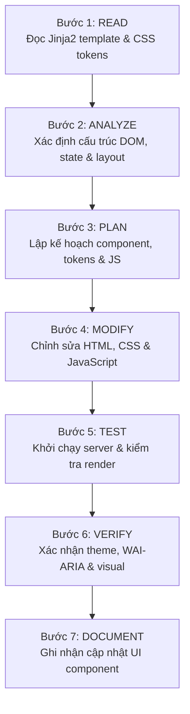

# Frontend Development Skill

## 1. Purpose
Skill này hướng dẫn AI Agent phân tích, thiết kế, triển khai và bảo trì giao diện người dùng Web (Frontend UI/UX) cho hệ thống `EventAI Pro`. Kỹ năng tập trung vào việc hiện thực hóa các trang giao diện bằng Jinja2 Template Engine, quản lý Design System theo phong cách Apple (Apple Design System) thông qua CSS Custom Properties (Tokens), xây dựng các hiệu ứng Glassmorphism, chuyển đổi chủ đề Sáng/Tối (Light/Dark Theme), quản lý vòng đời trạng thái giao diện (Loading, Error, Empty, Success) và chống giật màn hình (FOUC - Flash of Unstyled Content).

## 2. Capability
- **Phát triển Giao diện Web (Frontend Web Development):** Xây dựng và mở rộng hệ thống giao diện Server-side Rendering với Jinja2 Template inheritance (`base.html` -> child views).
- **Hệ thống Design System & Tokens:** Quản trị bảng màu HSL/Hex, Typography (SF Pro Display/Text, Inter), Spacing, Shadows, Border-radius và hiệu ứng mờ nền Backdrop Filter (Glassmorphism).
- **Tương tác DOM & Trạng thái UI:** Lập trình Vanilla JavaScript điều khiển thanh trượt sự kiện (Infinite Carousel Slider), phân trang sự kiện trang chủ (Home Events Pagination), bộ lọc tìm kiếm và các thông báo Flash Messages tự ẩn.
- **Khả năng tiếp cận & Trải nghiệm (Accessibility & UX):** Đảm bảo thuộc tính WAI-ARIA (`aria-label`, `aria-expanded`, `aria-hidden`), độ tương phản màu sắc và hỗ trợ điều hướng bàn phím.

## 3. Scope
- Cấu trúc và kế thừa layout Jinja2 trong `app/templates/` (`base.html`, `main/`, `events/`, `tickets/`, `admin/`, `ai/`, `auth/`, `checkin/`).
- Quản lý các biến CSS tokens và utility classes trong [app/static/css/style.css](file:///d:/Event_Management_AI/app/static/css/style.css).
- Xây dựng và tối ưu các hành vi tương tác client-side trong [app/static/js/main.js](file:///d:/Event_Management_AI/app/static/js/main.js).
- Quản lý 4 trạng thái giao diện: Trạng thái nạp dữ liệu (Loading Skeleton/Spinner), Trạng thái rỗng (Empty State), Trạng thái lỗi (Error Alert/Toast), Trạng thái hoàn thành (Success Confirmation).
- Xử lý đồng bộ chuyển đổi Light Mode, Dark Mode và Auto System Mode không gây FOUC.

## 4. Non-Scope
- Không can thiệp vào logic xử lý cơ sở dữ liệu SQLAlchemy ORM (thuộc skill [implementation](file:///d:/Event_Management_AI/.agents/skills/implementation/SKILL.md) và [database-design](file:///d:/Event_Management_AI/.agents/skills/database-design/SKILL.md)).
- Không thiết kế cấu trúc RESTful API backend (thuộc skill [api-development](file:///d:/Event_Management_AI/.agents/skills/api-development/SKILL.md)).
- Không xử lý các tính năng đặc thù màn hình cảm ứng di động, Drawer Navigation hay luồng quét Camera QR Code (thuộc skill [responsive-mobile](file:///d:/Event_Management_AI/.agents/skills/responsive-mobile/SKILL.md)).

## 5. When to Use
- Khi thêm mới một trang giao diện hoặc view mới trong các Blueprint của ứng dụng.
- Khi điều chỉnh hoặc làm mới phong cách thiết kế (UI Restyling), điều chỉnh màu sắc, khoảng cách, font chữ hoặc các thẻ card sự kiện.
- Khi khắc phục lỗi giao diện người dùng: lệch layout, vỡ khung card, lỗi hiển thị ảnh banner sự kiện, lỗi phông chữ hoặc FOUC.
- Khi cải thiện trải nghiệm tương tác (UX): bổ sung skeleton loading, thông báo toast hoặc điều chỉnh bộ điều khiển theme.

## 6. When NOT to Use
- Khi nhiệm vụ là tối ưu truy vấn cơ sở dữ liệu hoặc viết migration (dùng skill [database-design](file:///d:/Event_Management_AI/.agents/skills/database-design/SKILL.md)).
- Khi nhiệm vụ là viết endpoint API JSON không gắn liền với template HTML (dùng skill [api-development](file:///d:/Event_Management_AI/.agents/skills/api-development/SKILL.md)).
- Khi nhiệm vụ là xử lý luồng đối thoại AI đa tác tử ở backend (dùng skill [ai-agent](file:///d:/Event_Management_AI/.agents/skills/ai-agent/SKILL.md)).

## 7. Trigger Conditions
- Người dùng yêu cầu tạo mới giao diện cho sự kiện, trang quản trị hoặc trang mua vé.
- Có khiếu nại hoặc phát hiện lỗi về giao diện web (UI visual defect, contrast bug, theme flicker).
- Cần nhúng các thành phần AI widget vào giao diện web sẵn có.
- Cần tối ưu tính thẩm mỹ và tính khả dụng của các form nhập liệu người dùng.

## 8. Required Context
Agent cần nắm rõ:
- Cấu trúc cây kế thừa template Jinja2: `base.html` định nghĩa ``, ``, ``.
- Bảng mã biến CSS chính trong `:root` và `[data-theme="dark"]` (`--bg-primary`, `--bg-surface`, `--text-primary`, `--accent-blue`, `--glass-bg`, `--glass-border`, `--radius-lg`).
- Thư viện client-side được nhúng: Bootstrap 5.3 (Grid & Utilities), FontAwesome 6 (Icons), Chart.js (Dashboard), Html5-Qrcode (Scanner).

## 9. Source Files to Inspect
Trước khi sửa đổi hoặc tạo mới giao diện, Agent PHẢI đọc các tệp sau:
- [app/templates/base.html](file:///d:/Event_Management_AI/app/templates/base.html): Layout gốc chứa thẻ `<head>`, navigation bar, theme toggle, flash messages container, và footer.
- [app/templates/main/index.html](file:///d:/Event_Management_AI/app/templates/main/index.html): Trang chủ chứa Hero Section, AI Slider, Danh sách sự kiện và phân trang client-side.
- [app/templates/main/events.html](file:///d:/Event_Management_AI/app/templates/main/events.html): Giao diện tìm kiếm, lọc danh mục và lưới thẻ sự kiện.
- [app/templates/main/event_detail.html](file:///d:/Event_Management_AI/app/templates/main/event_detail.html): Giao diện chi tiết sự kiện, giá vé, lịch trình và form đăng ký vé.
- [app/templates/ai/chat_workspace.html](file:///d:/Event_Management_AI/app/templates/ai/chat_workspace.html): Giao diện trò chuyện tư vấn AI chuyên sâu.
- [app/static/css/style.css](file:///d:/Event_Management_AI/app/static/css/style.css): Hệ thống Design System, tokens, card styles, buttons và animations.
- [app/static/js/main.js](file:///d:/Event_Management_AI/app/static/js/main.js): Bộ điều khiển Theme, Slider, Pagination và các sự kiện client.

## 10. Documentation to Read
- [docs/architecture.md](file:///d:/Event_Management_AI/docs/architecture.md): Cấu trúc 3 tầng và vai trò của tầng Presentation Layer.
- [docs/requirements.md](file:///d:/Event_Management_AI/docs/requirements.md): Đặc tả yêu cầu giao diện người dùng và các luồng chức năng (FR-01 đến FR-10).
- [docs/user-stories.md](file:///d:/Event_Management_AI/docs/user-stories.md): Mô tả trải nghiệm người dùng của từng tác nhân (`attendee`, `organizer`, `staff`, `admin`).

## 11. Related Skills
- [requirements-analysis](file:///d:/Event_Management_AI/.agents/skills/requirements-analysis/SKILL.md): Tiếp nhận yêu cầu nghiệp vụ và Acceptance Criteria cho màn hình.
- [implementation](file:///d:/Event_Management_AI/.agents/skills/implementation/SKILL.md): Tích hợp dữ liệu từ Flask Controller vào template context (`render_template`).
- [responsive-mobile](file:///d:/Event_Management_AI/.agents/skills/responsive-mobile/SKILL.md): Kế thừa và tối ưu hóa giao diện cho thiết bị di động và tablet.
- [api-development](file:///d:/Event_Management_AI/.agents/skills/api-development/SKILL.md): Cung cấp các endpoint RESTful để frontend gửi `fetch()` requests.
- [testing](file:///d:/Event_Management_AI/.agents/skills/testing/SKILL.md): Kiểm thử tích hợp render HTML và kiểm tra HTTP status code.

## 12. Workflow
Agent PHẢI thực hiện tuần tự theo quy trình 7 bước sau:



### Bước 1: READ
1. Đọc tệp template cần can thiệp trong [app/templates/](file:///d:/Event_Management_AI/app/templates/) và kiểm tra kế thừa ``.
2. Đọc [app/static/css/style.css](file:///d:/Event_Management_AI/app/static/css/style.css) để tìm các CSS classes có sẵn (ví dụ: `.apple-card`, `.btn-primary`, `.glass-panel`).
3. Đọc [app/static/js/main.js](file:///d:/Event_Management_AI/app/static/js/main.js) để kiểm tra các hàm xử lý sự kiện đang tác động lên selector của trang.

### Bước 2: ANALYZE
1. Phân tích ngữ cảnh biến Jinja2 được controller truyền vào (ví dụ: `events`, `event`, `categories`, `pagination`).
2. Xác định các trạng thái giao diện cần đáp ứng:
   - Khi có dữ liệu: Lưới hiển thị các thẻ card đẹp mắt.
   - Khi không có dữ liệu: Hiển thị Empty State với icon và nút điều hướng rõ ràng.
   - Khi dữ liệu đang tải (AJAX/Fetch): Hiển thị spinner hoặc skeleton.
   - Khi có lỗi nhập liệu: Hiển thị viền đỏ và text cảnh báo dưới form input.
3. Kiểm tra tính tương thích với cả hai chế độ giao diện `[data-theme="light"]` và `[data-theme="dark"]`.

### Bước 3: PLAN
1. Lập danh sách các thẻ HTML ngữ nghĩa (`<main>`, `<section>`, `<article>`, `<header>`, `<footer>`).
2. Xác định các CSS classes tái sử dụng, tuyệt đối tránh viết inline styles (`style="..."`).
3. Xác định các thuộc tính hỗ trợ khả năng tiếp cận (`aria-label`, `role`, `tabindex`).

### Bước 4: MODIFY
1. Cập nhật mã nguồn Jinja2 template với cú pháp an toàn, sử dụng ``, ``, `` để bao quát mọi kịch bản dữ liệu.
2. Bổ sung các class CSS vào [app/static/css/style.css](file:///d:/Event_Management_AI/app/static/css/style.css) tuân thủ hệ thống biến CSS tokens đã định nghĩa.
3. Bổ sung xử lý sự kiện trong [app/static/js/main.js](file:///d:/Event_Management_AI/app/static/js/main.js) nếu cần tương tác client-side, sử dụng `addEventListener` và bọc trong phạm vi an toàn.

### Bước 5: TEST
1. Kiểm tra cú pháp Jinja2 và đảm bảo server khởi động bình thường không lỗi cú pháp.
2. Sử dụng lệnh thực thi kiểm thử tích hợp để đảm bảo các endpoint render template trả về HTTP 200:
   ```powershell
   .venv\Scripts\python -m pytest tests/test_events.py tests/test_tickets.py -v
   ```

### Bước 6: VERIFY
1. Kiểm tra chuyển đổi qua lại giữa Light Theme và Dark Theme: Tất cả các màu chữ, nền thẻ, đường viền phải đổi màu hài hòa, không có chữ đen trên nền tối.
2. Kiểm tra hiện tượng FOUC: Khi tải lại trang, không có hiện tượng chớp nháy màu trắng trước khi áp dụng Dark Mode.
3. Kiểm tra tính toàn vẹn: Không làm vỡ layout của các trang khác sử dụng chung CSS.

### Bước 7: DOCUMENT
1. Cập nhật ghi chú tài liệu nếu có component mới hoặc CSS utility mới được thêm vào.
2. Ghi nhận nhật ký thay đổi giao diện vào tài liệu liên quan.

## 13. Validation
Giao diện được coi là đạt tiêu chuẩn khi:
1. **Render hoàn hảo:** Mọi biến dữ liệu đều hiển thị đúng vị trí, ảnh fallback hoạt động khi link ảnh lỗi (`onerror="this.src='...'"`).
2. **Không lỗi Console:** Mở trình duyệt DevTools không xuất hiện lỗi JavaScript (uncaught TypeError, syntax error).
3. **Chuyển theme chuẩn xác:** Nút đổi theme tại thanh điều hướng chuyển đổi mượt mà trong 250ms và lưu trạng thái vào `localStorage`.
4. **Trạng thái rỗng chuyên nghiệp:** Mọi danh sách đều có Empty State thân thiện, không bao giờ để màn hình trống trơn.

## 14. Failure Handling
- **Trường hợp lỗi Jinja2 `UndefinedError`:** Kiểm tra controller xem đã truyền đúng tên biến trong `render_template(..., variable_name=value)` chưa.
- **Trường hợp vỡ layout trên màn hình nhỏ:** Kiểm tra các class flexbox/grid của Bootstrap, đảm bảo có `col-12 col-md-6 col-lg-4` hoặc kích hoạt skill [responsive-mobile](file:///d:/Event_Management_AI/.agents/skills/responsive-mobile/SKILL.md).
- **Trường hợp CSS không ăn (Cache):** Kiểm tra xem trình duyệt có đang cache file CSS hay không, thêm query versioning nếu cần thiết (`style.css?v=2.0`).

## 15. Security Considerations
- **Chống Cross-Site Scripting (XSS):** Luôn tận dụng cơ chế auto-escape mặc định của Jinja2. Tuyệt đối KHÔNG sử dụng bộ lọc `| safe` đối với các nội dung do người dùng nhập vào (bình luận, tên sự kiện, câu hỏi chat).
- **Thuộc tính liên kết an toàn:** Với mọi thẻ `<a>` mở ra liên kết bên ngoài có `target="_blank"`, bắt buộc phải có `rel="noopener noreferrer"`.
- **Bảo vệ CSRF:** Mọi form HTML POST phải chứa thẻ token bảo vệ `{{ csrf_token() }}` hoặc hidden input tương ứng nếu hệ thống bật CSRF protection.

## 16. Performance Considerations
- **Tránh FOUC:** Giữ đoạn script xử lý theme inline trong thẻ `<head>` của `base.html` để gán thuộc tính `data-theme` trước khi DOM body hiển thị.
- **Lazy Loading hình ảnh:** Luôn thêm thuộc tính `loading="lazy"` cho tất cả các thẻ `` danh sách sự kiện.
- **Debounce sự kiện:** Các sự kiện kéo trượt chuột hoặc tìm kiếm thời gian thực phải được debounce để tránh nghẽn luồng xử lý của trình duyệt.

## 17. Expected Output
- Tệp Jinja2 template hoàn thiện, cấu trúc ngữ nghĩa sạch đẹp, có xử lý đủ các trạng thái dữ liệu.
- Các quy tắc CSS bổ sung tuân thủ nghiêm ngặt bảng màu và phong cách Apple Design System trong `style.css`.
- Trải nghiệm giao diện cao cấp, mượt mà và trực quan cho người dùng cuối.

## 18. Completion Criteria
- [ ] Template kế thừa đúng chuẩn `base.html` và hiển thị đầy đủ thông tin nghiệp vụ.
- [ ] Đạt chuẩn hiển thị trên cả Light Mode và Dark Mode không bị xung đột màu sắc.
- [ ] Có đầy đủ Empty State và Error State khi dữ liệu trống hoặc truy vấn thất bại.
- [ ] 0 lỗi cú pháp Jinja2, 0 lỗi JavaScript runtime trong Console.
- [ ] Kiểm thử tích hợp HTTP trả về mã 200 OK.

## 19. Related GAPs
- **GAP-004:** Bổ sung năng lực cốt lõi phát triển và quản trị giao diện người dùng web chuyên nghiệp (P1).

## 20. Maintenance
- Cập nhật skill này khi dự án nâng cấp phiên bản Bootstrap, thay đổi thư viện biểu đồ, hoặc cấu trúc lại cây thư mục `app/templates/`.
