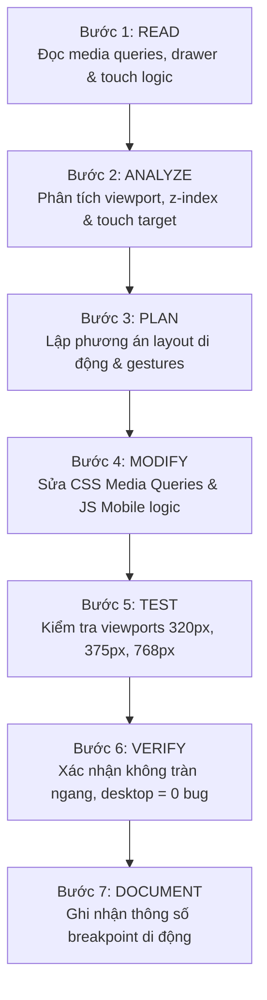

# Responsive Mobile Skill

## 1. Purpose

Skill này hướng dẫn AI Agent chuyên môn hóa việc kiểm tra, thiết kế và tối ưu hóa giao diện người dùng trên thiết bị di động và máy tính bảng (Mobile & Tablet Responsive) cho hệ thống `EventAI Pro`. Kỹ năng tập trung giải quyết các bài toán giao diện phức tạp trên màn hình cảm ứng: quản lý các điểm ngắt (Breakpoints từ 320px đến 768px), điều khiển Menu trượt (Apple iOS Slide-in Drawer), thanh điều hướng đáy cố định (Apple Bottom Navigation Bar), phân lớp thứ tự hiển thị (Z-index & Stacking Context), khóa cuộn nền (Scroll Locking), kích thước vùng chạm cảm ứng (Touch Target Size >= 44px) và luồng quét vé Camera QR Code trên di động.

## 2. Capability

- **Tối ưu hóa Điểm ngắt Di động (Mobile Breakpoints Optimization):** Đảm bảo giao diện hiển thị chuẩn xác trên toàn bộ dải kích thước màn hình phổ biến: 320px (iPhone SE, thiết bị nhỏ), 360px (Android tiêu chuẩn), 375px/390px (iPhone X/12/13/14), 414px/430px (iPhone Plus/Pro Max) và 768px (iPad Mini/Tablet).
- **Hệ thống Điều hướng Di động (Mobile Navigation System):** Vận hành đồng bộ menu trượt bên `appleMobileDrawer`, lớp phủ mờ `appleDrawerBackdrop`, nút kích hoạt và thanh điều hướng cố định dưới đáy `apple-bottom-nav`.
- **Quản trị Thứ tự Phân lớp (Z-index & Stacking Context):** Ngăn ngừa triệt để hiện tượng đè lớp giữa Header Navbar (z-index 1030), Lớp phủ mờ Backdrop (z-index 1040), Mobile Drawer (z-index 1050), và Cửa sổ Trợ lý AI (z-index 1060).
- **Trải nghiệm Chạm cảm ứng (Touch UX & Gestures):** Cử chỉ vuốt kéo danh sách sự kiện (Touch Swipe Slider), phản hồi haptic ảo và khóa cuộn trang (`body.mobile-drawer-open`) khi mở modal/drawer.
- **Tích hợp Phần cứng Camera QR (Mobile Hardware Camera Integration):** Tích hợp và xử lý an toàn luồng quét mã vé điểm danh qua Camera sau điện thoại (`facingMode: "environment"`) với thư viện `Html5Qrcode`.

## 3. Scope

- Quy tắc CSS Media Queries trong [app/static/css/style.css](file:///d:/Event_Management_AI/app/static/css/style.css) (`@media (max-width: 768px)`, `@media (max-width: 480px)`).
- Cấu trúc thanh điều hướng di động trong [app/templates/base.html](file:///d:/Event_Management_AI/app/templates/base.html) (`appleMobileDrawer`, `appleDrawerBackdrop`, `apple-bottom-nav`).
- Bộ điều khiển tương tác di động trong [app/static/js/main.js](file:///d:/Event_Management_AI/app/static/js/main.js) (`initMobileDrawer`, `initMobileNavigation`, `setupInfiniteSeamlessScroll`).
- Giao diện quét mã QR điểm danh di động trong [app/templates/checkin/index.html](file:///d:/Event_Management_AI/app/templates/checkin/index.html).
- Cửa sổ trợ lý AI dạng Bottom Sheet trên di động trong [app/templates/ai/chat_workspace.html](file:///d:/Event_Management_AI/app/templates/ai/chat_workspace.html).

## 4. Non-Scope

- Không lập trình logic xử lý vé tại backend Flask (thuộc skill [implementation](file:///d:/Event_Management_AI/.agents/skills/implementation/SKILL.md)).
- Không thiết kế API JSON kiểm tra vé (thuộc skill [api-development](file:///d:/Event_Management_AI/.agents/skills/api-development/SKILL.md)).
- Không quản trị layout tổng thể trên desktop rộng (thuộc skill [frontend-development](file:///d:/Event_Management_AI/.agents/skills/frontend-development/SKILL.md)).

## 5. When to Use

- Khi phát hiện hiện tượng tràn ngang (Horizontal Scrollbar / Overflow-X bug) trên thiết bị di động.
- Khi các nút bấm hoặc liên kết trên di động quá nhỏ, khó bấm bằng ngón tay (Touch Target < 44px).
- Khi menu drawer bị che khuất, backdrop không mờ hoặc không đóng được khi bấm phím Esc.
- Khi luồng quét Camera QR trên di động bị lỗi quyền truy cập hoặc không tự động chọn camera sau.
- Khi người dùng cuộn trang làm thanh điều hướng đáy che mất nội dung quan trọng ở chân trang (Footer Cut-off).

## 6. When NOT to Use

- Khi nhiệm vụ là tối ưu hóa câu lệnh SQL trong database (dùng skill [database-design](file:///d:/Event_Management_AI/.agents/skills/database-design/SKILL.md)).
- Khi nhiệm vụ là điều chỉnh prompt tư vấn AI (dùng skill [rag-prompt](file:///d:/Event_Management_AI/.agents/skills/rag-prompt/SKILL.md)).
- Khi thiết kế layout dành riêng cho màn hình Desktop lớn (dùng skill [frontend-development](file:///d:/Event_Management_AI/.agents/skills/frontend-development/SKILL.md)).

## 7. Trigger Conditions

- Màn hình hiển thị bị vỡ khi kiểm tra ở chế độ Responsive Design Mode trong trình duyệt.
- Thanh trượt sự kiện AI Recommendations không phản hồi cử chỉ vuốt ngón tay trên màn hình cảm ứng.
- Lỗi đè lớp z-index: Modal hoặc Drawer bị chìm dưới các phần tử `position: fixed` khác.
- Lỗi cuộn kép (Dual Scrolling): Mở drawer nhưng trang web phía sau vẫn cuộn được.

## 8. Required Context

Agent cần nắm rõ:

- Bảng phân cấp Z-Index chuẩn của hệ thống:
  - Base Content: `z-index: 1 - 10`
  - Sticky Headers: `z-index: 100 - 500`
  - Navbar Header: `z-index: 1030`
  - Backdrop Blur Overlay: `z-index: 1040`
  - Apple Mobile Slide Drawer: `z-index: 1050`
  - AI Assistant Bottom Sheet: `z-index: 1060`
  - Toast Alerts / Flash Messages: `z-index: 1090`
- Kỹ thuật khóa cuộn: Class `.mobile-drawer-open` được gán vào `document.body` có thuộc tính `overflow: hidden; touch-action: none;`.
- Thư viện Camera QR: `Html5Qrcode` khởi tạo với cấu hình `fps: 10`, `qrbox: { width: 250, height: 250 }`, `facingMode: "environment"`.

## 9. Source Files to Inspect

Trước khi tối ưu hoặc khắc phục lỗi mobile, Agent PHẢI đọc các tệp sau:

- [app/static/css/style.css](file:///d:/Event_Management_AI/app/static/css/style.css): Phần định nghĩa Drawer (`.apple-mobile-drawer`), Bottom Nav (`.apple-bottom-nav`) và Media Queries `@media (max-width: 768px)`.
- [app/static/js/main.js](file:///d:/Event_Management_AI/app/static/js/main.js): Hàm `initMobileDrawer()` (dòng 368-437) và `initMobileNavigation()` (dòng 443-478).
- [app/templates/base.html](file:///d:/Event_Management_AI/app/templates/base.html): Khối DOM `#appleMobileDrawer`, `#appleDrawerBackdrop`, `#appleBottomNav`.
- [app/templates/checkin/index.html](file:///d:/Event_Management_AI/app/templates/checkin/index.html): Luồng camera scanner và form nhập mã thủ công dự phòng.
- [app/templates/ai/chat_workspace.html](file:///d:/Event_Management_AI/app/templates/ai/chat_workspace.html): Bottom Sheet responsive của cửa sổ AI chat.

## 10. Documentation to Read

- [docs/architecture.md](file:///d:/Event_Management_AI/docs/architecture.md): Nguyên tắc thiết kế Presentation Layer.
- [docs/requirements.md](file:///d:/Event_Management_AI/docs/requirements.md): Yêu cầu phi chức năng về tính tương thích di động (NFR).
- [docs/customer-requirement.md](file:///d:/Event_Management_AI/docs/customer-requirement.md): Yêu cầu nghiệp vụ về điểm danh QR trên điện thoại thông minh của nhân viên soát vé.

## 11. Related Skills

- [frontend-development](file:///d:/Event_Management_AI/.agents/skills/frontend-development/SKILL.md): Cung cấp nền tảng Jinja2 templates và hệ thống CSS Tokens.
- [implementation](file:///d:/Event_Management_AI/.agents/skills/implementation/SKILL.md): Kết nối các luồng xử lý backend hỗ trợ API di động.
- [api-development](file:///d:/Event_Management_AI/.agents/skills/api-development/SKILL.md): Cung cấp endpoint xác thực vé `/checkin/verify-api`.
- [testing](file:///d:/Event_Management_AI/.agents/skills/testing/SKILL.md): Thực hiện kiểm thử tự động ngăn ngừa lỗi hồi quy logic.

## 12. Workflow

Agent PHẢI thực hiện tuần tự theo quy trình 7 bước sau:



### Bước 1: READ

1. Đọc [app/static/css/style.css](file:///d:/Event_Management_AI/app/static/css/style.css) tại các khối media queries `@media (max-width: 768px)` và `@media (max-width: 480px)`.
2. Đọc [app/static/js/main.js](file:///d:/Event_Management_AI/app/static/js/main.js) để nắm rõ cách thức đóng/mở Drawer (`window.openMobileDrawer`, `window.closeMobileDrawer`) và cách chuyển tab tại `initMobileNavigation()`.
3. Đọc [app/templates/checkin/index.html](file:///d:/Event_Management_AI/app/templates/checkin/index.html) để rà soát thẻ container chứa video camera `#qr-reader`.

### Bước 2: ANALYZE

1. Xác định kích thước màn hình gây lỗi (320px, 375px, 414px hoặc 768px).
2. Kiểm tra phần tử gây tràn ngang (Overflow X Element) bằng cách inspect DOM hoặc tìm các thẻ có `width` cố định vượt quá viewport.
3. Rà soát Stacking Context: Kiểm tra xem có phần tử cha nào chứa `transform`, `filter`, `perspective`, hoặc `opacity < 1` làm cô lập stacking context của Drawer hoặc Modal hay không.
4. Đánh giá kích thước vùng bấm (Touch Target): Đảm bảo các nút bấm (`.btn`, `.nav-link`, `.page-btn-circle`) có kích thước tối thiểu `44px x 44px`.

### Bước 3: PLAN

1. Lập kế hoạch điều chỉnh CSS: Chuyển các đơn vị tuyệt đối (`px`) sang đơn vị tương đối (`%`, `vw`, `rem`, `clamp()`).
2. Thiết kế khoảng đệm chân trang (Bottom Padding): Bổ sung `padding-bottom: 80px` cho thẻ `<main>` để tránh bị che bởi thanh `apple-bottom-nav`.
3. Thiết lập cơ chế fallback cho Camera: Khi camera không khả dụng, tự động hiển thị ô nhập mã vé bằng tay.

### Bước 4: MODIFY

1. Bổ sung hoặc điều chỉnh CSS rules trong [app/static/css/style.css](file:///d:/Event_Management_AI/app/static/css/style.css):
   - Sử dụng `overflow-x: hidden;` cho container tổng.
   - Sử dụng `transform: translateX(-100%);` kết hợp `transition: transform 0.3s cubic-bezier(0.16, 1, 0.3, 1);` cho hiệu ứng trượt drawer chuẩn Apple.
2. Cập nhật mã JavaScript trong [app/static/js/main.js](file:///d:/Event_Management_AI/app/static/js/main.js) để xử lý sự kiện cảm ứng (touch start, touch move, touch end) và bàn phím (phím Escape đóng drawer).
3. Đảm bảo [app/templates/checkin/index.html](file:///d:/Event_Management_AI/app/templates/checkin/index.html) có cơ chế xử lý ngoại lệ camera `Html5Qrcode.getCameras()`.

### Bước 5: TEST

1. Khởi chạy môi trường và kiểm tra viewports di động:
   - 320px: Kiểm tra hiển thị tiêu đề thẻ sự kiện và nút đăng ký.
   - 375px: Kiểm tra drawer trượt ra chiếm tối đa 85% chiều rộng màn hình.
   - 768px: Kiểm tra điểm giao thoa giữa giao diện di động và máy tính bảng.
2. Chạy test suite để đảm bảo không làm gãy logic backend:

   ```powershell
   .venv\Scripts\python -m pytest tests/test_checkin.py -v
   ```

### Bước 6: VERIFY

1. **Kiểm tra cuộn ngang:** Kéo ngang toàn bộ màn hình, đảm bảo không có thanh cuộn ngang xuất hiện.
2. **Kiểm tra cuộn trang:** Mở drawer, thử cuộn ngón tay trên màn hình, xác nhận nội dung trang phía sau bị khóa cuộn hoàn toàn.
3. **Kiểm tra hồi quy Desktop:** Đổi lại kích thước màn hình > 992px, xác nhận menu Desktop và thanh điều hướng hoạt động bình thường, thanh Bottom Nav tự động ẩn (`display: none;`).

### Bước 7: DOCUMENT

1. Cập nhật các thông số breakpoint và hành vi di động mới vào tài liệu kỹ thuật.
2. Ghi chép cách giải quyết vấn đề z-index hoặc camera nếu có xử lý mới.

## 13. Validation

Hệ thống di động đạt chuẩn khi thỏa mãn:

1. **Hoàn toàn không tràn ngang:** Không có thanh cuộn ngang xuất hiện trên bất kỳ thiết bị nào từ 320px trở lên.
2. **Drawer & Backdrop nhạy bén:** Nhấp nút Menu mở Drawer mượt mà trong 300ms; nhấp Backdrop hoặc nhấn phím Escape đóng Drawer ngay lập tức.
3. **Bottom Navigation chuẩn xác:** Tab đang mở được highlight sáng rõ; nhấp tab AI mở ngay cửa sổ tư vấn.
4. **Vùng chạm chuẩn Apple HIG:** Tất cả các nút bấm trên di động đều có kích thước tối thiểu 44px x 44px, khoảng cách giữa các nút tối thiểu 8px.
5. **Camera Scanner ổn định:** Quét mã QR phản hồi tức thì và có sẵn ô nhập thủ công nếu không cấp quyền camera.

## 14. Failure Handling

- **Trường hợp Camera bị từ chối cấp quyền (NotAllowedError):** Bắt lỗi trong Promise catch của `Html5Qrcode`, hiển thị thông báo hướng dẫn người dùng bật quyền và tự động kích hoạt khung nhập mã vé dự phòng.
- **Trường hợp Drawer bị chìm dưới nội dung:** Kiểm tra phần tử cha của Drawer xem có thuộc tính `transform` hoặc `filter` không, nếu có hãy di chuyển khối HTML của Drawer ra sát thẻ đóng `</body>`.
- **Trường hợp bàn phím ảo đẩy vỡ layout:** Sử dụng đơn vị `dvh` (Dynamic Viewport Height) hoặc `svh` thay cho `vh` cố định.

## 15. Security Considerations

- **Yêu cầu HTTPS / Localhost:** Trình duyệt di động chỉ cấp quyền Camera (`getUserMedia`) trên kết nối an toàn (HTTPS hoặc `localhost`).
- **Bảo mật dữ liệu vé quét:** Dữ liệu đọc từ mã QR phải được gửi qua API an toàn bằng phương thức POST kèm CSRF token, không hiển thị dữ liệu nhạy cảm trên URL.

## 16. Performance Considerations

- **Tối ưu hóa Pin & CPU:** Dừng luồng quét camera (`html5QrCode.stop()`) ngay khi quét thành công hoặc khi người dùng rời khỏi trang.
- **Tận dụng phần cứng GPU:** Luôn sử dụng `transform` và `opacity` để thực hiện diễn hoạt trượt drawer, tránh sử dụng `left`, `right`, `width` gây tái tính toán layout (Layout Reflow).

## 17. Expected Output

- Hệ thống giao diện di động đạt chất lượng như một ứng dụng Native App hoàn chỉnh.
- Menu drawer, thanh điều hướng đáy và luồng quét QR hoạt động trơn tru trên mọi thiết bị cảm ứng.

## 18. Completion Criteria

- [ ] Xác minh hiển thị không lỗi trên các kích thước: 320px, 360px, 375px, 390px, 414px, 768px.
- [ ] Khóa cuộn màn hình (`overflow: hidden`) hoạt động chính xác khi mở menu drawer.
- [ ] Không có phần tử nào bị đè lấp sai thứ tự z-index.
- [ ] Thư viện quét camera QR tích hợp luồng fallback an toàn.
- [ ] Giao diện máy tính để bàn (Desktop) không phát sinh bất kỳ lỗi hồi quy nào.

## 19. Related GAPs

- **GAP-004:** Bổ sung năng lực cốt lõi tối ưu hóa giao diện di động và tương tác phần cứng quét vé QR (P1).

## 20. Maintenance

- Cập nhật skill này khi phát hành dòng thiết bị di động với tỉ lệ màn hình mới hoặc khi nâng cấp thư viện quét QR `Html5Qrcode`.
