# ARCHITECTURE GAP ANALYSIS — BÁO CÁO PHÂN TÍCH KHOẢNG CÁCH KIẾN TRÚC

**Dự án:** EventAI Pro (`Event_Management_AI`)  
**Giai đoạn:** Phase 2 — Gap Analysis  
**Mục tiêu:** Phân tích sự chênh lệch giữa Kiến trúc Thực tế (Current Architecture) trong mã nguồn và Kiến trúc Mục tiêu (Intended Target Architecture). Không thực hiện sửa đổi kiến trúc trong giai đoạn này.

---

## 1. KIẾN TRÚC HIỆN TẠI (CURRENT ARCHITECTURE)

Hệ thống hiện tại được tổ chức theo mô hình **Kiến trúc 3 Tầng Mở rộng (Extended 3-Tier Enterprise Architecture)** kết hợp phân hệ **Trí tuệ Nhân tạo Kép (Dual-Engine AI & Multi-Agent Ensemble)**:

```mermaid
flowchart TD
    subgraph Presentation_Layer["1. PRESENTATION LAYER (FRONTEND)"]
        UI_Jinja["Jinja2 Templates (27 HTML files)<br/>Apple Design System (3,048 lines CSS)<br/>Dark/Light Theme Switcher & FOUT Script"]
        UI_Mobile["Mobile Drawer Navigation<br/>iOS Bottom Nav Tab Bar<br/>HTML5-QRCode Web Camera Scanner"]
        UI_Chat["Floating AI Chat Widget (ai_chat.js)<br/>Full-page AI Workspace (chat_workspace.html)"]
    end

    subgraph Application_Layer["2. APPLICATION & LOGIC LAYER (BACKEND)"]
        App_Factory["Flask Application Factory (app/__init__.py)"]
        Blueprints["8 Modular Blueprints (66 Routes):<br/>main, auth, events, tickets, checkin, admin, ai, notifications"]
        Auth_RBAC["Session Auth & RBAC Decorator (@role_required):<br/>admin, organizer, staff, attendee"]
        AI_Gateway["Dual-Engine AI Gateway (gemini_service.py):<br/>Gemini 2.0/3.6 Flash <--> Local Grounded Mock Engine"]
        AI_Services["Business AI Services:<br/>rag_service, recommendation_service, predictive_service, sentiment_service"]
        Multi_Agent["Multi-Agent Ensemble (app/agents/):<br/>Orchestrator, Requirement, Retrieval, Critic, Response, Knowledge, Recommendation<br/>Message Bus (Audit Log) + SQL Tool + Vector Tool"]
    end

    subgraph Data_Layer["3. DATA & PERSISTENCE LAYER (DATABASE)"]
        ORM["SQLAlchemy 2.0 ORM Models (11 Models)"]
        SQLite_DB["SQLite 3NF Database (11 Tables, 13 B-Tree Indexes)"]
        File_Storage["Static Asset Storage (app/static/qr_codes/*.svg)"]
    end

    Presentation_Layer --> Application_Layer
    Application_Layer --> Data_Layer
```

---

## 2. KIẾN TRÚC MỤC TIÊU (INTENDED TARGET ARCHITECTURE)

Kiến trúc Mục tiêu duy trì tính ổn định của mô hình 3 Tầng hiện tại, nhưng giải quyết các điểm nghẽn về:
- **Chuẩn hóa API Contracts:** Toàn bộ 66 routes được tài liệu hóa và đồng nhất cơ chế xử lý lỗi.
- **Ranh giới Phân hệ AI:** Phân định rõ ràng giữa **Luồng Hỏi đáp Tức thời (Single-Agent Grounded RAG Chatbot)** phục vụ khách tham dự và **Luồng Tư vấn Chuyên sâu (Multi-Agent Advisory Pipeline)** phục vụ ban tổ chức.
- **Loại bỏ Thư mục Trùng lặp:** Chuẩn hóa toàn bộ assets và service về không gian tên `app/`.
- **Hệ thống Kỹ năng Agent:** 18 kỹ năng chuẩn hóa hướng dẫn AI Agent vận hành độc lập.

---

## 3. CÁC ĐIỂM KHÁC BIỆT CHÍNH (DIFFERENCES)

| Khía cạnh | Kiến trúc Hiện tại (Current) | Kiến trúc Mục tiêu (Intended Target) | Mức độ chênh lệch |
| :--- | :--- | :--- | :---: |
| **Quản trị Module Root** | Tồn tại thư mục shim `agents/`, `models/`, `services/` và thư mục asset duplicate `prompts/` ở root | Toàn bộ module nằm trong `app/`; tài liệu hóa rõ ràng vai trò shim tương thích ngược | Thấp (Minor) |
| **Truy vấn ORM** | Còn 13 vị trí dùng `Model.query.get_or_404(id)` gây cảnh báo `LegacyAPIWarning` | 100% sử dụng phương thức chuẩn `db.get_or_404(Model, id)` theo chuẩn Flask-SQLAlchemy 3.0+ | Trung bình (Medium) |
| **Fallback Model AI** | `candidate_models` chỉ có `3.6-flash`, `2.5-flash`, `1.5-flash`, thiếu model GA `gemini-2.0-flash` | Bổ sung `gemini-2.0-flash` vào danh sách ưu tiên fallback của Gemini Gateway | Cao (High) |
| **Đặc tả API** | `docs/api.md` chỉ ghi nhận 9 endpoints | Đặc tả đầy đủ 66 endpoints chuẩn RESTful với mã lỗi HTTP và JSON response schema | Cao (High) |
| **Phủ sóng Skills của Agent** | 12 skills cũ, thiếu 17 mục cấu trúc chuẩn; thiếu 6 skills năng lực thực tế | 18 skills chuẩn hóa 100%, đầy đủ 17 mục và quy trình `ĐỌC → PHÂN TÍCH → SỬA → TEST` | Rất cao (Critical) |

---

## 4. CÁC THÀNH PHẦN CÒN THIẾU (MISSING COMPONENTS)

1. **Endpoint Kiểm tra Sức khỏe Hệ thống (`/health`):** Chưa có route chuyên biệt trả về trạng thái CSDL và API phục vụ Docker/K8s liveness probe.
2. **Tài liệu Kiến trúc Frontend & Giao diện Di động:** Chưa có `docs/frontend-architecture.md` và `docs/responsive-mobile.md`.
3. **Bộ Tài liệu Quản trị Kỹ năng (Skill Governance Suite):** Chưa có các tài liệu chỉ mục, ma trận năng lực và sơ đồ phụ thuộc của Skills.
4. **Cấu hình Tập trung cho Test Runner:** Chưa có `pytest.ini` định nghĩa `pythonpath = .`, dẫn tới lệnh `pytest` đơn thuần không tự nhận diện `app`.

---

## 5. RANH GIỚI BỊ LỆCH HOẶC CHƯA RÕ (INCORRECT / UNCLEAR BOUNDARIES)

- **Ranh giới giữa Single-Agent RAG và Multi-Agent Ensemble:**
  - Cả hai đều nằm chung trong route `/ai/` (`ai.py`).
  - *Hiện tại:* `/ai/chat` sử dụng `answer_event_query` (RAG Single-Agent), trong khi `/ai/multi-agent/advisory` sử dụng `OrchestratorAgent` (Multi-Agent Pipeline).
  - *Đánh giá:* Logic mã nguồn phân tách tốt, nhưng tài liệu kiến trúc chưa vẽ rõ hai luồng dữ liệu độc lập này, dễ gây hiểu lầm là hệ thống chỉ có một chatbot đơn lẻ.

---

## 6. TRÁCH NHIỆM BỊ TRÙNG LẶP (DUPLICATE RESPONSIBILITIES)

1. **Thư mục Prompt Templates:**
   - `prompts/` (ở thư mục gốc) chứa 5 file txt: `critic_prompt.txt`, `knowledge_prompt.txt`, `recommendation_prompt.txt`, `requirement_prompt.txt`, `response_prompt.txt`.
   - `app/prompts/multi_agent/` cũng chứa đúng 5 file txt này với nội dung giống hệt 100%.
   - Mã nguồn thực tế tại `app/agents/*.py` nạp từ `app/prompts/multi_agent/`. Thư mục `prompts/` ở root hoàn toàn dư thừa.

---

## 7. KHOẢNG CÁCH PHÂN HỆ AI (AI ARCHITECTURE GAP)

- **Độ linh hoạt của Danh sách Model:** Cần đảm bảo model GA `gemini-2.0-flash` luôn đứng trong danh sách ưu tiên cao trước khi rơi vào mock fallback.
- **Quản lý Lịch sử Hội thoại:** Route `/ai/chat` đã hỗ trợ 6 lượt hội thoại gần nhất (`turn[-6:]`), tuy nhiên cần bổ sung tài liệu hướng dẫn Agent cách kiểm thử context window và token limit.

---

## 8. KHOẢNG CÁCH CƠ SỞ DỮ LIỆU (DATABASE GAP)

- **Hiện trạng:** 11 bảng CSDL 3NF, 13 B-Tree indexes, ràng buộc Foreign Keys hoạt động trơn tru không lỗi.
- **Khoảng cách:** Không có lỗi về cấu trúc hay logic CSDL. Điểm cần hoàn thiện duy nhất là tài liệu hóa chi tiết trạng thái `IMPLEMENTED` cho 2 bảng mới `notifications` và `event_faqs` trong `docs/database-design.md`.

---

## 9. KHOẢNG CÁCH RANH GIỚI FRONTEND / BACKEND (FRONTEND / BACKEND BOUNDARY GAP)

- **Tính nhất quán giữa Form submission và JSON API:**
  - Một số route hỗ trợ cả form post truyền thống (Jinja2 redirect) và JSON API (ví dụ `/checkin/verify-api` trả JSON, trong khi `/tickets/register/<id>` trả Jinja2 form).
  - Cần tài liệu hóa rõ ràng trong `docs/api.md` endpoint nào phục vụ HTML UI và endpoint nào phục vụ RESTful JSON client.

---

## 10. KHUYẾN NGHỊ ĐIỀU CHỈNH (RECOMMENDED CORRECTIONS)

1. **Khắc phục cảnh báo ORM:** Thay thế toàn bộ 13 lệnh `Model.query.get_or_404(id)` bằng `db.get_or_404(Model, id)`.
2. **Cập nhật Model Gateway:** Bổ sung `gemini-2.0-flash` vào `candidate_models` trong `app/services/gemini_service.py`.
3. **Chuẩn hóa và Mở rộng Skills:** Nâng cấp 12 skills cũ và bổ sung 6 skills mới; thiết lập `.agents/skills/README.md`.
4. **Bổ sung Tài liệu Thiếu:** Khởi tạo `docs/frontend-architecture.md`, `docs/responsive-mobile.md`, cập nhật `docs/api.md`.
5. **Dọn dẹp Tài liệu:** Sửa 20 links tuyệt đối trong `README.md`.
