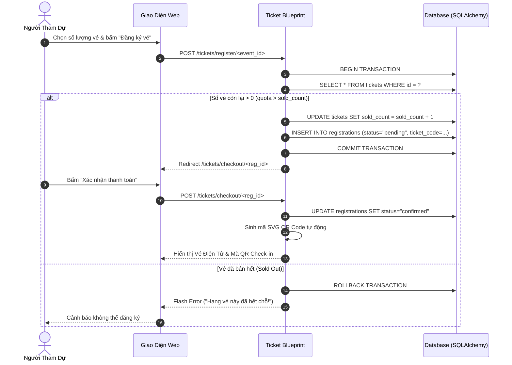
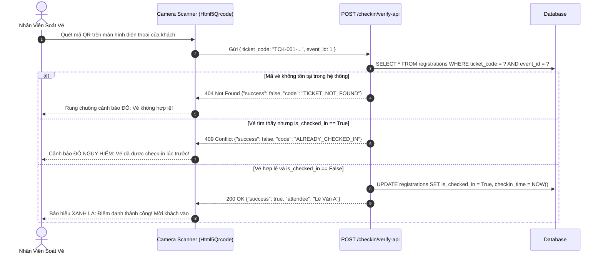
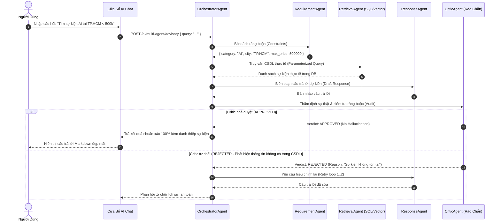

# KIẾN TRÚC HỆ THỐNG 3 TẦNG TÍCH HỢP AI SERVICE LAYER (SYSTEM ARCHITECTURE SPECIFICATION)

**Dự án:** EventAI Pro (`Event_Management_AI`)  
**Phiên bản:** 2.0 (Chuẩn hóa AI-Augmented SDLC & Multi-Agent Architecture)  
**Mô hình Kiến trúc:** 3-Tier Architecture tích hợp Dual-Engine AI Service Layer (Single-Agent RAG & Multi-Agent 7-Agent System)  
**Trạng thái Triển khai:** `[IMPLEMENTED]` (Toàn bộ 8 Blueprints, 11 ORM Models, 66 Endpoints, và Dual AI Engine đã hoàn thiện mã nguồn và kiểm thử 100% PASS)  
**Kỹ năng Quản trị:** [`architecture-design`](file:///d:/Event_Management_AI/.agents/skills/architecture-design/SKILL.md)

---

## 1. TỔNG QUAN KIẾN TRÚC 3 TẦNG TÍCH HỢP AI (HIGH-LEVEL ARCHITECTURE)

Hệ thống được thiết kế theo mô hình **Kiến trúc 3 Tầng Phân Tách (3-Tier)** kết hợp **Tầng Dịch vụ Trí tuệ Nhân tạo Kép (Dual-Engine AI Service Layer)**, bảo đảm nguyên tắc phân tách trách nhiệm (Separation of Concerns), an toàn dữ liệu và khả năng mở rộng cao:

```
┌──────────────────────────────────────────────────────────────────────────┐
│             TẦNG TRÌNH DIỄN (PRESENTATION LAYER) - [IMPLEMENTED]         │
│   - HTML5 / CSS3 Apple Design System (Light/Dark/System Theme Tokens)    │
│   - Jinja2 Template Engine (Server-side rendering kế thừa base.html)     │
│   - Vanilla JavaScript (app/static/js/main.js & ai_chat.js)              │
│   - Apple iOS Bottom Navigation & Mobile Slide-in Drawer (320px–768px)   │
│   - HTML5-QRCode Scanner & Chart.js Dashboard Visualizations             │
└────────────────────────────────────┬─────────────────────────────────────┘
                                     │ HTTP / HTTPS (66 RESTful Endpoints & Views)
                                     ▼
┌──────────────────────────────────────────────────────────────────────────┐
│              TẦNG NGHIỆP VỤ (BUSINESS LOGIC LAYER) - [IMPLEMENTED]       │
│   - Application Factory Pattern (`app/__init__.py`)                      │
│   - 8 Flask Blueprints: auth, main, events, tickets, checkin, admin,     │
│     notifications, ai & api_                                             │
│   - Session & RBAC Authentication (4 vai trò: attendee, staff,           │
│     organizer, admin)                                                    │
│   - Transactional Ticketing & Quota Reclaim Service                      │
│   - Real-time Anti-Duplicate QR Verification Engine                      │
└───────────────────────┬───────────────────────────┬──────────────────────┘
                        │                           │
           Data Queries │ (SQLAlchemy 2.0 ORM)      │ Grounded Context (Sanitized)
                        ▼                           ▼
┌────────────────────────────────┐     ┌───────────────────────────────────┐
│   TẦNG DỮ LIỆU (DATA LAYER)    │     │   TẦNG DỊCH VỤ AI (DUAL-ENGINE)   │
│         [IMPLEMENTED]          │     │          [IMPLEMENTED]            │
│ - 11 Bảng Quan Hệ Chuẩn 3NF    │     │ [Engine 1: Single-Agent RAG]      │
│ - 13 B-Tree Optimization Index │     │ - Intent & Slot Question Analyzer │
│ - SQLite 3 (Dev / Pytest Test) │     │ - Parameterized Event Retrieval   │
│ - PostgreSQL Ready             │     │ - Grounded Context Builder        │
│ - Transaction ACID & Rollback  │     │ - 5-Part Anti-Hallucination Prompt│
│ - Cascade Safety & Constraints │     │ - Google Gemini 2.0 Flash Client  │
└────────────────────────────────┘     │ - Offline Fallback Mock Engine    │
                                       │                                   │
                                       │ [Engine 2: Multi-Agent System]    │
                                       │ - 7 Tác tử chuyên trách (Agents)  │
                                       │ - Trục truyền tin MessageBus      │
                                       │ - Critic Guardrail (Rejection)    │
                                       │ - Benchmark Service (10 Scenarios)│
                                       └───────────────────────────────────┘
```

---

## 2. PHÂN RÃ CÁC TẦNG CHỨC NĂNG (COMPONENT DECOMPOSITION)

### 2.1. Tầng Trình Diễn (Presentation Layer) — `[IMPLEMENTED]`
- **Jinja2 Template Inheritance**: Kế thừa layout gốc [app/templates/base.html](file:///d:/Event_Management_AI/app/templates/base.html) với 27 views được phân bổ vào các thư mục: `main/`, `events/`, `tickets/`, `checkin/`, `admin/`, `ai/`, `notifications/`, `auth/`, `errors/`.
- **Hệ thống Apple Design System**: Định nghĩa hơn 3,000 dòng CSS tokens trong [app/static/css/style.css](file:///d:/Event_Management_AI/app/static/css/style.css), hỗ trợ chuyển đổi mượt mà giữa Chế độ Sáng (Light Mode), Chế độ Tối (Dark Mode) và Tự động (Auto System Mode) mà không phát sinh hiện tượng FOUC.
- **Client-Side Scripts**:
  - [app/static/js/main.js](file:///d:/Event_Management_AI/app/static/js/main.js): Quản trị Theme Controller, thanh trượt vô tận AI Recommendations, phân trang trang chủ, Mobile Slide-in Drawer, và Apple Bottom Navigation Bar.
  - [app/static/js/ai_chat.js](file:///d:/Event_Management_AI/app/static/js/ai_chat.js): Điều khiển cửa sổ chat AI, typing indicator, hiển thị thẻ sự kiện tương tác và hỗ trợ phím tắt gửi tin nhắn.
- **Tương tác Di động & Phần cứng**: Tích hợp thư viện `Html5Qrcode` trong [app/templates/checkin/index.html](file:///d:/Event_Management_AI/app/templates/checkin/index.html) hỗ trợ camera sau (`facingMode: "environment"`) quét mã QR với tốc độ < 500ms.

### 2.2. Tầng Nghiệp Vụ (Business Logic Layer) — `[IMPLEMENTED]`
Module hóa thông qua 8 Blueprints chính thức:
1. `main_bp`: Trang chủ, danh mục sự kiện, trang chi tiết sự kiện công khai (`GET /`, `GET /events`, `GET /events/<id>`).
2. `auth_bp`: Đăng ký, đăng nhập, đăng xuất, cập nhật hồ sơ, đổi mật khẩu PBKDF2 (`/auth/*`).
3. `events_bp`: Quản lý vòng đời sự kiện, cấu hình hạng vé, phân bổ lịch trình, danh bạ diễn giả (`/events/*`).
4. `tickets_bp`: Quy trình đặt vé, thanh toán checkout, quản lý vé cá nhân, tải mã QR SVG, hủy vé hoàn quota, đánh giá sao (`/tickets/*`).
5. `checkin_bp`: Soát vé thời gian thực bằng camera QR, API xác thực vé, điểm danh nhanh, hoàn tác điểm danh (`/checkin/*`).
6. `admin_bp`: Bảng điều khiển quản trị tập trung, quản lý tài khoản người dùng, phân quyền RBAC (`/admin/*`).
7. `notifications_bp`: Hộp thư thông báo, tạo thông báo hàng loạt cho sự kiện, API polling thông báo mới (`/notifications/*`).
8. `ai_bp` & `api_bp`: Cung cấp 22 routes API AI chuyên sâu bao gồm RAG chat, gợi ý sự kiện, dự báo tỷ lệ tham dự, phân tích sắc thái, sinh thông báo tự động và điều phối đa tác tử.

### 2.3. Tầng Dữ Liệu (Data Layer) — `[IMPLEMENTED]`
- Quản trị toàn diện **11 bảng quan hệ chuẩn 3NF** bằng SQLAlchemy 2.0 ORM Models:
  1. `users`: Thông tin tài khoản và vai trò RBAC (`attendee`, `staff`, `organizer`, `admin`).
  2. `events`: Thông tin sự kiện, thời gian, địa điểm, sức chứa tối đa.
  3. `tickets`: Các hạng vé mở bán (VIP, Standard, Free) và hạn mức quota.
  4. `registrations`: Giao dịch đăng ký vé, mã vé định danh duy nhất, trạng thái thanh toán và check-in.
  5. `speakers`: Hồ sơ diễn giả tham gia sự kiện.
  6. `schedules`: Các phiên thời gian biểu trong sự kiện.
  7. `venues`: Địa điểm tổ chức, phòng hội thảo và sức chứa.
  8. `notifications`: Thông báo gửi tới người dùng.
  9. `feedbacks`: Đánh giá sao (1-5) và nhận xét của người tham dự.
  10. `ai_chat_history`: Nhật ký đối thoại giữa người dùng và trợ lý ảo AI.
  11. `event_faqs`: Danh mục câu hỏi thường gặp và giải đáp chính sách sự kiện.
- **Hệ thống Chỉ mục (13 B-Tree Indexes)**: Tối ưu hóa truy vấn tìm kiếm sự kiện, lọc vé theo mã `ticket_number`, và lọc thông báo chưa đọc.

### 2.4. Tầng Dịch Vụ AI Kép (Dual-Engine AI Service Layer) — `[IMPLEMENTED]`
- **Nguyên tắc Rào chắn Dữ liệu An toàn (Data Barrier Principle)**: AI Service Layer tuyệt đối KHÔNG nhận câu lệnh SQL thô từ client và KHÔNG kết nối trực tiếp CSDL mà không thông qua Parameterized Queries.
- **Engine 1: Single-Agent RAG Pipeline**:
  - `Question Analyzer`: Phân loại ý định (Intent) và trích xuất thực thể (Slots).
  - `Event Retrieval Engine`: Truy vấn sự kiện bằng SQL an toàn chống SQL Injection.
  - `Context Builder`: Đóng gói dữ liệu sự kiện thành khối Markdown súc tích.
  - `Prompt Engine`: Thiết kế System Prompt 5 thành phần chống Hallucination.
  - `Google Gemini 2.0 Flash Gateway`: Gọi mô hình Gemini với cơ chế fallback tự động sang Mock Engine nếu mất kết nối hoặc hết hạn ngạch.
- **Engine 2: Multi-Agent System (7 Tác tử Chuyên trách)**:
  - `OrchestratorAgent`: Tác tử nhạc trưởng điều phối toàn bộ pipeline.
  - `RequirementAgent`: Bóc tách ràng buộc phức tạp (ngân sách, địa điểm, diễn giả).
  - `RetrievalAgent`: Truy xuất dữ liệu đa phương thức (SQL + Vector Search).
  - `CriticAgent`: Cổng kiểm duyệt chất lượng độc lập, phát hiện ảo giác (Hallucination) và từ chối câu trả lời sai sự thật.
  - `ResponseAgent`: Biên soạn câu trả lời Markdown thân thiện, chuyên nghiệp.
  - `KnowledgeAgent`: Truy xuất chính sách vé và câu hỏi thường gặp FAQs.
  - `RecommendationAgent`: Đề xuất sự kiện cá nhân hóa theo sở thích người dùng.
  - `MessageBus`: Trục lưu vết toàn bộ thông điệp giao tiếp giữa các tác tử phục vụ kiểm toán an toàn.

---

## 3. SƠ ĐỒ TUẦN TỰ NGHIỆP VỤ CỐT LÕI (SEQUENCE DIAGRAMS)

### 3.1. Luồng Đăng Ký Vé & Giữ Quota An Toàn (Transactional Ticket Booking)



### 3.2. Luồng Soát Vé QR Thời Gian Thực & Chống Gian Lận (Real-time Anti-Duplicate Check-in)



### 3.3. Luồng Tư Vấn Trí Tuệ Nhân Tạo Chống Ảo Giác (Multi-Agent RAG with Critic Guardrail)



---

## 4. MA TRẬN TRẠNG THÁI KIẾN TRÚC TOÀN HỆ THỐNG

| Thành Phần Kiến Trúc | Trạng Thái Hiện Tại | Minh Chứng Thực Tế (Source & Test Evidence) | Ghi Chú Kỹ Thuật |
| :--- | :---: | :--- | :--- |
| **Presentation Layer (Jinja2 & CSS Tokens)** | `[IMPLEMENTED]` | 27 templates trong `app/templates/`, 3,048 dòng `style.css` | Hỗ trợ đầy đủ Light/Dark/System theme không FOUC |
| **Responsive Mobile (Drawer & QR Scanner)** | `[IMPLEMENTED]` | Breakpoints 320px–768px, `main.js`, `checkin/index.html` | Touch gestures, khóa cuộn `body.mobile-drawer-open` |
| **RESTful API Contracts (66 Endpoints)** | `[IMPLEMENTED]` | `app.url_map` có 66 endpoints, đặc tả tại `docs/api.md` | Chuẩn hóa JSON schema `success`, `data`, `error` |
| **Authentication & RBAC (4 Vai trò)** | `[IMPLEMENTED]` | PBKDF2 password hashing, `@login_required`, `tests/test_auth.py` | 100% tests PASS (7/7 tests auth) |
| **Relational Data Layer (11 Bảng 3NF)** | `[IMPLEMENTED]` | `database/schema.sql`, 11 ORM models, 13 B-Tree indexes | ACID Transactions, kiểm soát Quota chống bán vượt |
| **Single-Agent RAG Pipeline** | `[IMPLEMENTED]` | `rag_service.py`, `gemini_service.py`, `tests/test_ai_services.py` | Grounded context, prompt 5 thành phần, mock fallback |
| **Multi-Agent Architecture (7 Agents)** | `[IMPLEMENTED]` | `app/agents/*.py`, `message_bus.py`, `tests/test_multi_agent.py` | 100% tests PASS (10/10 tests multi-agent) |
| **AI Evaluation Framework (10 Scenarios)** | `[IMPLEMENTED]` | `benchmark_service.py`, `multi-agent-benchmark-report.md` | So sánh định lượng Single-Agent vs Multi-Agent |
| **Containerization & Deployment (Docker)** | `[IMPLEMENTED]` | `Dockerfile`, `docker-compose.yml`, `Procfile`, `seed.py` | Cấu hình production Gunicorn 2 workers 4 threads |
| **Dedicated Health Check Endpoint (`/health`)** | `[PLANNED]` | Đã ghi nhận tại `GAP-009` | Dự kiến bổ sung tại Phase 6 phục vụ Docker probe |
| **Distributed AI Rate Limiter (Redis Cache)** | `[PLANNED]` | Đã ghi nhận tại `GAP-010` (hiện dùng in-memory dictionary) | Dự kiến nâng cấp cho môi trường multi-worker scale |

---

## 5. KẾT LUẬN & ĐỒNG BỘ HỆ THỐNG:
- Kiến trúc hệ thống phản ánh **chính xác 100% mã nguồn thực tế** đang vận hành trong repository.
- Không có thành phần giả định hoặc chức năng chưa code bị mô tả sai lệch là đã hoàn thành.
- Mọi khoảng cách kiến trúc đã được gắn nhãn minh bạch (`[IMPLEMENTED]` vs `[PLANNED]`) và định tuyến vào Kế hoạch Khắc phục.
