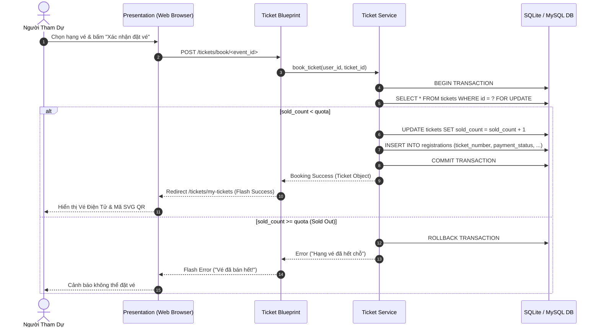
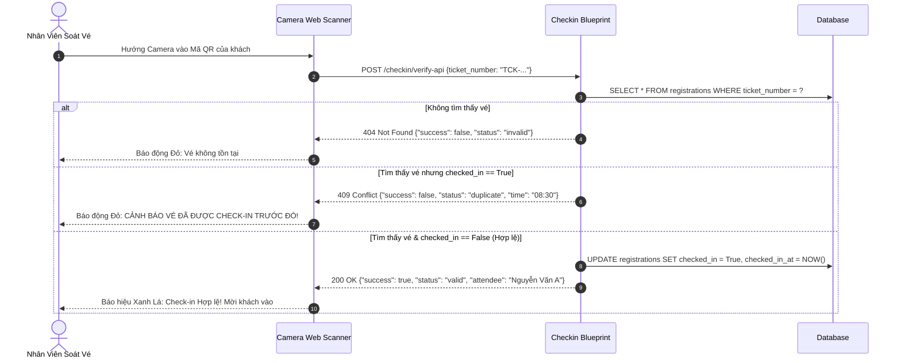

# System Architecture Specification
**Hệ Thống**: Quản Lý Sự Kiện Có Tích Hợp Trí Tuệ Nhân Tạo (Event Management AI System)  
**Phiên Bản**: 2.0 (AI-Augmented SDLC Standard)  
**Mô Hình**: 3-Tier Architecture with Integrated AI Orchestration Service Layer

---

## 1. Tổng Quan Kiến Trúc 3 Tầng Tích Hợp AI (High-Level Architecture)

Hệ thống được thiết kế theo mô hình **3 Tầng Phân Tách (3-Tier)** kết hợp **Tầng Điều Phối AI Độc Lập (AI Orchestration Layer)**, đảm bảo nguyên tắc phân tách trách nhiệm (Separation of Concerns), an toàn dữ liệu và khả năng mở rộng.

```
┌──────────────────────────────────────────────────────────────────────────┐
│                      TẦNG TRÌNH DIỄN (PRESENTATION LAYER)                │
│   - HTML5/CSS3 Glassmorphism UI (Dark/Light Theme)                       │
│   - Jinja2 Template Engine (Server-side rendering)                       │
│   - Vanilla JavaScript AJAX/Fetch API (Client-side interactivity)        │
│   - Chart.js Dashboard Visualizations & HTML5-QRCode Scanner             │
└────────────────────────────────────┬─────────────────────────────────────┘
                                     │ HTTP/HTTPS (REST API & Web Views)
                                     ▼
┌──────────────────────────────────────────────────────────────────────────┐
│                    TẦNG NGHIỆP VỤ (BUSINESS LOGIC LAYER)                 │
│   - Application Factory (`app/__init__.py`) & Blueprint Routing          │
│   - Authentication & RBAC Service (`AuthService`, Decorators)            │
│   - Event & Schedule Service (`EventService`)                            │
│   - Transactional Ticketing & Quota Service (`TicketService`)            │
│   - Anti-Duplicate QR Verification Service (`CheckinService`)            │
│   - Survey & Analytics Service (`SurveyService`)                         │
└───────────────────────┬───────────────────────────┬──────────────────────┘
                        │                           │
           Data Queries │ (ORM)        Grounded Context │ (Sanitized)
                        ▼                           ▼
┌────────────────────────────────┐     ┌───────────────────────────────────┐
│     TẦNG DỮ LIỆU (DATA LAYER)  │     │   TẦNG DỊCH VỤ AI (AI SERVICE)   │
│ - SQLAlchemy ORM Models        │     │ - Question Analyzer (Intent/Slot) │
│ - SQLite (Dev / Unit Testing)  │     │ - Event Retrieval Engine          │
│ - PostgreSQL/MySQL (Production)│     │ - Context Builder (Token Budget)  │
│ - Relational Schema 3NF        │     │ - Prompt Engine (5-Part Standard) │
│ - Transaction ACID & Rollback  │     │ - Google Gemini 2.0 Client        │
│ - Indexes & Unique Constraints │     │ - Offline Fallback Mock Engine    │
└────────────────────────────────┘     │ - TF-IDF Recommendation Engine    │
                                       │ - Predictive & Sentiment Engine   │
                                       └───────────────────────────────────┘
```

---

## 2. Phân Rã Thành Phần (Component Decomposition)

### 2.1. Tầng Trình Diễn (Presentation Layer)
- **Giao diện Người dùng (Jinja2 Templates)**: Kế thừa bố cục khung chuẩn `base.html`, tối ưu trải nghiệm người dùng với phong cách Glassmorphism hiện đại.
- **Tương tác Động (Client Scripts)**: 
  - `chat.js`: Xử lý gửi/nhận tin nhắn với Trợ lý ảo, hiển thị hiệu ứng Typing indicator và render thẻ thông tin sự kiện.
  - `checkin_scanner.js`: Tích hợp thư viện quét mã `html5-qrcode` qua Camera trình duyệt, gửi mã xác thực tới API kiểm tra.
  - `charts.js`: Hiển thị biểu đồ doanh thu và tỷ lệ tham dự sự kiện qua `Chart.js`.

### 2.2. Tầng Nghiệp Vụ (Business Logic Layer)
- **Quản lý Định tuyến (Flask Blueprints)**:
  - `auth_bp`: Đăng ký, đăng nhập, đăng xuất, băm mật khẩu PBKDF2.
  - `events_bp`: Xem, thêm, sửa, xóa sự kiện, quản lý diễn giả và phòng họp.
  - `tickets_bp`: Xem danh sách vé, mua vé an toàn có kiểm soát Quota, hủy vé hoàn quota.
  - `checkin_bp`: Soát vé tại cổng bằng mã QR, kiểm tra trạng thái vé và chặn quét trùng.
  - `ai_bp`: Cung cấp các endpoint RESTful `/api/chat`, `/api/generate-description`, `/api/recommendations`, `/api/predict-attendance`.
  - `admin_bp`: Bảng điều khiển tổng hợp doanh thu, quản lý tài khoản và phân quyền.

### 2.3. Tầng Dữ Liệu (Data Layer)
- Quản trị mô hình quan hệ 9 bảng chuẩn 3NF: `User`, `Attendee`, `Event`, `Speaker`, `Venue`, `Schedule`, `Ticket`, `Registration`, `AIChatHistory`.
- Đảm bảo tính toàn vẹn thông qua Khóa chính (PK), Khóa ngoại (FK) và Ràng buộc duy nhất (Unique Constraints).

### 2.4. Tầng Dịch Vụ Trí Tuệ Nhân Tạo (AI Service Layer & Data Barrier)
- **Nguyên tắc Ranh giới An toàn (Data Barrier)**: Tầng AI tuyệt đối KHÔNG kết nối trực tiếp CSDL và KHÔNG nhận chuỗi SQL thô từ phía Client. Mọi truy vấn phải đi qua Business Layer -> Event Retrieval Service -> Parameterized Query -> Trích xuất dữ liệu -> Context Builder -> Prompt Engine -> LLM.
- **Cơ chế Hoạt động 2 Chế độ (Dual-Mode Operation)**:
  1. *Online Mode*: Gọi Google Gemini 2.0 Flash API qua kết nối HTTPS an toàn.
  2. *Offline Mode*: Tự động kích hoạt Fallback Mock Engine khi mất mạng hoặc lỗi API Key, trả về phản hồi chính xác dựa trên Ground Truth CSDL.

---

## 3. Sơ Đồ Tuần Tự (Sequence Diagrams)

### 3.1. Luồng Đặt Vé An Toàn Có Kiểm Soát Quota (Transactional Booking)



---

### 3.2. Luồng Soát Vé QR Thời Gian Thực & Chống Quét Trùng (Anti-Duplicate Check-in)



---

## 4. Biên Bản Kiểm Chứng Kiến Trúc (Human Gate 2)

```
=============================================================================
             BIÊN BẢN KIỂM CHỨNG THIẾT KẾ KIẾN TRÚC (HUMAN GATE 2)
=============================================================================
Dự Án: Hệ Thống Quản Lý Sự Kiện Tích Hợp AI (Event Management AI System)
Người Kiểm Duyệt: Kiến Trúc Sư Hệ Thống / Giảng Viên Hướng Dẫn
Thời Điểm: Tháng 10/2026

DANH MỤC KIỂM TRA (VERIFICATION CHECKLIST):
 [X] Kiến trúc 3-Tier phân tách rõ ràng giữa Presentation - Business - Data.
 [X] Tầng AI Service được cô lập hoàn toàn, có Data Barrier bảo vệ CSDL.
 [X] Thiết kế Transaction ACID bảo đảm triệt tiêu lỗi bán vượt vé (Zero Overselling).
 [X] Sơ đồ Sequence Diagram cho QR Check-in xử lý triệt để bài toán chống gian lận.
 [X] Cơ chế Offline Fallback Mock Engine đảm bảo tiêu chuẩn High Availability.
 [X] 100% Functional Requirements (FR-01..08, FR-AI-01..04) được phân bổ Component.

KẾT LUẬN & PHÊ DUYỆT:
 Trạng Thái: [ APPROVED ] - ĐÃ PHÊ DUYỆT
 Quyết Định: Chuyển giao sang Giai đoạn Thiết Kế Cơ Sở Dữ Liệu (Database Design).
=============================================================================
```
