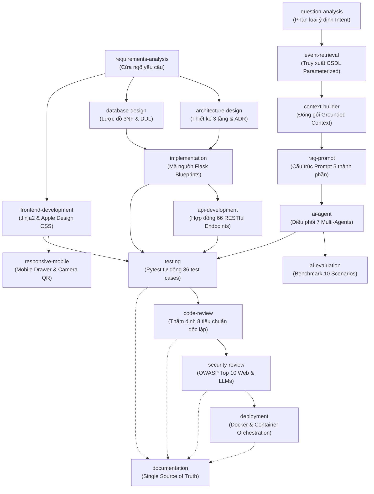

# SKILLS DEPENDENCY MAP — SƠ ĐỒ QUAN HỆ PHỤ THUỘC KỸ NĂNG CỦA AI AGENT

**Dự án:** EventAI Pro (`Event_Management_AI`)  
**Mục tiêu:** Định nghĩa rõ ràng mối quan hệ phụ thuộc (Dependencies), thứ tự ưu tiên và các luồng phối hợp (Execution Workflows) giữa các Kỹ năng của AI Agent khi xử lý các loại tác vụ kỹ thuật khác nhau trong dự án.

---

## 1. SƠ ĐỒ TỔNG THỂ PHỤ THUỘC KỸ NĂNG (OVERALL DEPENDENCY GRAPH)



---

## 2. CÁC LUỒNG PHỐI HỢP KỸ NĂNG THEO LOẠI TÁC VỤ (EXECUTION PIPELINES)

### 2.1. Luồng Phát triển Tính năng Mới (New Feature Workflow)
```text
requirements-analysis
        ↓
architecture-design
        ↓
database-design
        ↓
implementation (kèm api-development & frontend-development nếu có giao diện)
        ↓
testing (Viết & chạy test cases tự động)
        ↓
code-review (Thẩm định độc lập)
        ↓
documentation (Cập nhật SRS, API, DB, Test Report)
```

### 2.2. Luồng Khắc phục Lỗi Kỹ thuật (Bug Fix Workflow)
```text
testing (Tái hiện bug bằng failing test case)
        ↓
implementation (Xác định root cause & sửa code)
        ↓
testing (Chạy verify test case & regression test)
        ↓
code-review (Xác nhận không phát sinh code smell)
        ↓
documentation (Ghi nhận vào change log hoặc known issues)
```

### 2.3. Luồng Phát triển & Tối ưu Tính năng AI (AI Feature Workflow)
```text
requirements-analysis
        ↓
question-analysis (Bóc tách intent & thực thể)
        ↓
event-retrieval (Truy vấn CSDL an toàn)
        ↓
context-builder (Ghép nối Grounded Context)
        ↓
rag-prompt (Thiết kế System/User Prompt)
        ↓
ai-agent / ai-evaluation (Đo lường độ trễ, token, ảo giác)
        ↓
testing (Pytest AI endpoints)
        ↓
security-review (Prompt Injection & PII Sanitization)
        ↓
documentation (Cập nhật chatbot-architecture.md & benchmark report)
```

### 2.4. Luồng Phát triển Giao diện & Trải nghiệm Di động (UI/UX Mobile Workflow)
```text
requirements-analysis
        ↓
frontend-development (Jinja2 Template & Apple Design Tokens)
        ↓
responsive-mobile (Tối ưu Breakpoints, Drawer, Touch, Camera QR)
        ↓
testing (Integration rendering & form submission tests)
        ↓
code-review (Kiểm tra CSS specificity, z-index, accessibility)
        ↓
documentation (Cập nhật frontend-architecture.md & responsive-mobile.md)
```

### 2.5. Luồng Đóng gói & Phát hành (Release & Deployment Workflow)
```text
testing (Chạy 100% full test suite 36/36 tests)
        ↓
security-review (Quét secrets, kiểm tra RBAC, dependency CVEs)
        ↓
deployment (Build Docker image, kiểm tra docker-compose, healthcheck probe)
        ↓
documentation (Cập nhật deployment.md, version tagging, release notes)
```

---

## 3. NGUYÊN TẮC GIẢI QUYẾT BẾ TẮC (DEADLOCK RESOLUTION)
- Tuyệt đối không thiết lập vòng lặp phụ thuộc tuần hoàn (Circular Dependency).
- Khi có xung đột giữa thiết kế kiến trúc và yêu cầu nghiệp vụ: Dừng tại `architecture-design`, quay lại `requirements-analysis` để làm rõ qua Human Gate 1.
- Khi có lỗi kiểm thử sau khi sửa code: Tuyệt đối không sửa test để test pass; bắt buộc quay lại `implementation` để giải quyết nguyên nhân gốc rễ.
